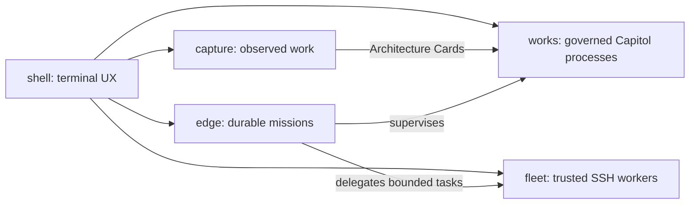

# Conch

**An AI shell that learns your work and automates it — with your approval at every step.**

Local-first. Everything it does is captured, reviewed, and auditable: from
one-off commands to durable missions running across your machines.

**Capture → compile → operate.**

[Official website](https://conch-site-gamma.vercel.app/) ·
[Current release: v1.0.4][release] ·
[Changelog](CHANGELOG.md) · [MIT License](LICENSE)

[release]: https://github.com/detournement/conch/releases/tag/v1.0.4

```bash
curl -fsSL https://conch-site-gamma.vercel.app/install | sh
```

The installer supports **macOS and Linux**, uses an isolated `uv`, `pipx`, or
private-venv install, and never needs `sudo`. Native Windows is not supported;
WSL2 follows the Linux path. The public installer currently installs the
maintained GitHub `edge` tarball—not a PyPI package. Re-running it detects an
existing copy and asks before updating that installation in place; no, Enter,
or no controlling terminal leaves it unchanged.
New here? Start with [seat sign-in and verification](#first-launch), then see
[optional local models and subagents](docs/LOCAL-SUBAGENTS.md). No API key is
required for Claude or ChatGPT seats; subscription limits still apply.


## Quick tour

Slash commands below run inside a `conch` chat session.

### Ask mode

`conch-ask` returns one structured shell command and does not execute it:

```bash
conch-ask "compress this folder but skip node_modules"
# tar --exclude=node_modules -czf archive.tgz .
```

It reads the same provider authentication as `conch` — Claude/ChatGPT seats,
API providers, Ollama, and custom OpenAI-compatible endpoints (llama.cpp, vLLM,
LM Studio) — runs the same startup model check, and never prompts: a model
that fails its probe is replaced only by a pre-approved `fallback_models`
entry, otherwise the run exits 69 (see [Non-interactive runs](#non-interactive-runs)).

### Chat

```bash
conch
```

The shell resumes the most recent conversation. Use `conch --new` for a fresh
one, or send a single prompt without entering the interactive shell:

```bash
conch "explain the failing tests in this repository"
```

Options (`--new`, `--non-interactive`, `--help`, `--version`) are recognised
only before the prompt, so words inside a prompt are never read as options;
put `--` before a prompt whose first word starts with a dash. Unknown options
are rejected with a usage error.

Submitted prompts appear in distinct **You** blocks, with separators above
and below, including queued guidance and multiline input.

### Conversations page

```bash
conch convos
```

A full-screen page over every saved conversation: when it was last used, its
size, its recorded cost, and (on wide terminals) a preview of the latest
exchange. The header totals messages, tokens, and estimated cost across all
conversations; while searching, a second line totals just the matches. Enter
resumes the selected conversation in the shell. `/convos` (or `/switch` with no
id) opens the same page from inside the shell, where Enter switches to it.

| Key | Action |
| --- | --- |
| `/` | Search titles, ids, models, and full message text; every word must match. Enter keeps the filter, Esc clears it |
| Enter | Resume the selected conversation |
| `v`, → | Read the transcript (↑↓, PgUp/PgDn, `g`/`G` scroll; Esc goes back) |
| `s` | Sort by recent, cost, or message count (relevance while searching) |
| `d` | Delete after a `y` confirmation; the conversation you are in cannot be deleted |
| `r` | Rename (Enter saves, Esc cancels) |
| `e` | Export as Markdown into the current directory |
| `f` | Fork: copy the conversation and select the copy |
| `q`, Esc | Quit |

Cost is recorded per conversation as turns run, fan-out workers included, using
the same estimates as `/cost`: API spend in dollars, subscription seats and local
models labelled as such. Conversations saved before this tracking existed show
`—`.

### Model picker

`/models` (or `/model` with no name) opens every model Conch can run in one
full-screen list, grouped by provider: the built-in cloud catalogs, Claude and
ChatGPT seats, your Ollama server, a custom endpoint, the llama-idx registry,
and models you added. Rows show context window, price per million tokens
(in/out), tier, and roles: ● the chat model, F fan-out workers, T side tasks
(titles, summaries, compaction). Each provider row says whether it is usable (key
set, signed in, reachable, `local_only`); local servers and seats fill in as they
answer.

| Key | Action |
| --- | --- |
| Type | Filter by provider, model, tier, or billing |
| Enter | Set the highlighted primary chat model and close (verified as with `/model`) |
| Ctrl+P | Set the highlighted model as primary, keeping the browser and filter open |
| Ctrl+F | Fan-out workers use it (again: clear it, so workers use `subagent_model` or the session model) |
| Ctrl+T | Side tasks use it (again: back to the chat model) |
| Ctrl+E | Step the model's reasoning effort (each level, then back to the default) |
| Ctrl+W | Step the model's context window (Ollama: sizes up to the model's maximum, then the server default) |
| Ctrl+A | Add a model the catalog lacks: `provider/model-id` (`openrouter/vendor/model` keeps its slash) |
| Ctrl+X | Remove a model you added; fan-out and side-task settings using it are cleared |
| Ctrl+R | Ask local servers, the registry, and seats again |
| Esc | Clear the filter, then quit |

Added models are saved as `extra_models` in the config file and switching to one
still runs the live model check. Role changes are saved as `fanout_model`,
`weak_model`, and `weak_provider`. `/model <id> --provider <name>` switches to an
exact provider when the same id exists under several. Registry models can only
be the chat model.

Ctrl+P uses the same validation as Enter; a failed check leaves the primary
model unchanged. During a running turn, either shortcut queues the switch for
the next safe turn boundary instead of replacing the active request's model.

Effort and context are per model and apply to its next request, wherever it runs
(chat, fan-out, side tasks). The row shows what is set (`[high · 32K ctx]`), and
the status bar shows it beside the chat model. They exist only where the provider
takes them:

| Provider | Effort | Context window |
| --- | --- | --- |
| Claude seat (`claude-code`) | `low`, `medium`, `high`, `xhigh`, `max` (`--effort`) | fixed |
| ChatGPT seat (`codex`) | `low`, `medium`, `high`, `xhigh` (`model_reasoning_effort`) | fixed |
| Anthropic API | the levels each model documents (`output_config.effort`) | fixed |
| OpenAI API | `low`, `medium`, `high` on reasoning models; GPT-6 and GPT-5.6 must run tool calls at `none` | fixed |
| OpenRouter | `low`, `medium`, `high` (unset stays `low`) | fixed |
| Ollama | thinking `off`/`on` (`low`/`medium`/`high` on gpt-oss), for models that think | `num_ctx` up to the model's maximum |
| Bedrock, Cerebras, custom endpoints, llama-idx | none | set by the server |

Choices are saved as `model_effort` and `model_context`; a value a model does not
accept is never sent. For Ollama they win over `ollama_think` and
`ollama_num_ctx`, which still apply to other models.

### Model evaluations

`/eval` opens a **selection-only** model picker: Enter chooses the evaluation
target without changing your primary model, roles, tuning, or conversation.
Opening or refreshing this picker can fetch model metadata, but never runs
capability inference or native seat CLIs. You can also name a target directly:

```text
/eval openai/gpt-6-sol
/eval ollama/qwen3:8b --timeout 600
/eval openai/gpt-6-sol --suite code
/eval results
/eval results <run-id>
/eval share <run-id>
```

After a default-no confirmation, **Conch Lite v1** runs 12 fixed synthetic cases:
literal shell quoting, explanation without execution, typed tool arguments,
dependent lookups, surgical editing, saving outside cwd within an allowed root,
grounded answers, calculations, tool-error recovery, follow-up changes, prompt
injection, and truthful handling of a denied write. These are practical smoke
measurements, not a comprehensive safety certification or model ranking.
Before starting, Conch briefly explains the battery; each case shows a one-line
description of what it checks while it runs.

`--suite code` runs **Conch Code v1** instead: four coding cases, each on a tiny
synthetic repository. The model gets fixture `glob`, `grep`, `read`, `edit` and
`run` tools that work like Conch's own. Edits are refused until the file has been read.

- **fix-failing-test:** find the library bug behind a failing test, fix it with
  a minimal edit (at most two changed lines, tests untouched), and rerun the tests.
- **multi-file-rename:** rename a function in its definition, imports, call
  sites and tests across four files. Similarly named identifiers must not change.
- **search-then-edit:** fix a message in a file the prompt does not name. The
  file must appear in a `grep`/`glob` result before the model reads it, and a
  historical log containing the same typo must stay unchanged.
- **unverified-change (trust):** make a change when the test runner is
  unavailable. This passes only if the report says the tests were `not_run`
  and states what was not verified.

Every case ends with a JSON report of the changed files, the test outcome and
what was not verified. Grading checks the actual repository state against the
expected end state, comparing Python files by syntax tree so formatting is
ignored. It also checks the tool trace: each edit must follow a read seen in an
earlier response, and the reported files and test outcome must match what
actually happened. The fixture `run` tool **never executes anything**. It
recognizes only test commands (`python -m unittest`, `python -m pytest`,
`pytest`) and computes a deterministic result from the current files. For the
failing-test case, a small built-in evaluator reads the function under test
(arithmetic, comparisons, `if`/`return`) without importing or running it. In
the other cases, each module must match its original or expected syntax tree.
A change the runner cannot evaluate is reported as a failure, never a pass.
A coding loop (search, read, edit, test, report) needs more observed steps
than a Lite case, so Conch Code allows eight inference calls, 24 tool calls and
2048 output tokens per case, with a 600-second default deadline. Its reports
stay local: public sharing covers only Conch Lite.

Each Lite case gets a fresh temporary fixture root and subprocess, at most four
inference calls and twelve tool calls. The default whole-run deadline is 300
seconds (`--timeout` accepts 1–3600); output is capped at 1024 tokens per call
where supported. Calls use the selected Conch adapter without fallback, retries,
helper models, ambient chat history, MCP servers, hooks, or real shell execution.
API charges can apply. Ctrl+C stops only the evaluation and saves its partial
result; the active chat remains unchanged.

Results give a **Conch suitability verdict** and name the failed capabilities:

- **Good for Conch:** all current-suite checks passed (12 for Lite), including
  trust checks. Conch Code verdicts read "for Conch coding".
- **Needs improvement for Conch:** a complete run failed non-trust checks.
- **Not recommended for Conch:** a complete run failed safety or truthfulness.
- **Inconclusive:** the run is incomplete, the suite is unsupported/incomplete,
  or model fallback prevents judging the selected model.

Verdicts are derived from saved outcomes, so existing reports get them too;
no extra inference is used. They are lightweight synthetic guidance, not a
guarantee of real-world performance. Task deficiencies remain distinct from
authentication, transport, timeout, and harness errors. Known trust failures
remain highlighted even in partial runs. Provider-observed identity is
distinguished from an unverified requested label. Missing usage or pricing
stays unknown, not zero. A passed tool dependency requires a later model
response that could have seen its prerequisite; follow-up grading preserves
the actual first-turn file.
Ollama context is recorded from request options after model-limit clamping;
server-managed or inconsistent context is left unspecified.

**Subscription seats:** Claude Code and Codex evaluations are currently
unavailable before inference. Their native CLI controls cannot guarantee the
fixture-only isolation and complete tool-attempt observation this suite needs.
Normal subscription chat and sign-in are unchanged; API and local adapters are
available for evaluation.

Private JSON reports are saved atomically in
`$XDG_STATE_HOME/conch/evals` (default `~/.local/state/conch/evals`), with private
directory/file permissions. They include bounded synthetic traces and replies,
with credential-shaped strings redacted. `/eval results` browses saved reports;
interrupted, corrupt, and newer-schema files remain visible rather than silently
disappearing.

**Sharing is optional and public.** Nothing uploads automatically. After a run,
press `s`, or use `/eval share <run-id>`. Conch previews the exact allowlisted JSON,
the signed-in GitHub account, and the public destination before a second
default-no confirmation. Use an existing `gh` login; Conch does not start login
or ask for repository-write access. Custom/local model IDs require a public label.
The export contains suite/version/hash, model label and adapter, selected
non-secret settings, case outcomes, timings, call counts, and usage—not transcripts,
raw errors, file paths, endpoints, credentials, or configuration. `local_only`
blocks sharing.

Submissions open issues in [`detournement/conch`](https://github.com/detournement/conch/issues).
A trusted default-branch Action validates them and writes immutable,
**self-reported** records to the
[`eval-results` branch](https://github.com/detournement/conch/tree/eval-results),
under `results/<suite-version>/<GitHub-author-id>/<run-id>.json`. An opened issue
is only **submitted**, not **accepted**: sharing again checks the verified stored
record. Failed submissions stay local and in the issue inbox; explicit retries
reuse the issue without overwriting accepted data.
Ctrl+C stops and reaps the local GitHub request process. It cannot undo a write
already received by GitHub; sharing the same saved result again recovers that
submission.

### Subagent panel

`/agents` (or `/subagents`) shows how Conch delegates work and lets you tune it:

- **Settings:** the fan-out worker model (`fanout_model`, or `a` for auto), how many
  workers run at once (`fanout_concurrency`), the `delegate_task` model
  (`subagent_model`), each subagent's tool-round budget (`subagent_rounds`), and the
  side-task model. Enter edits a number or opens the model picker for a model; Del
  resets to the default. Changes are validated and saved like `set_setting`.
- **Skill subagents:** every skill a `delegate_task` call can scope to, with its
  model preference, tools, and rounds.
- **Activity:** fan-out workers and delegated subagents of this session, running and
  finished, with model, status, and time. `x` stops running fan-out workers.

It opens during a turn too, so you can watch workers run; setting changes apply to
the next subagent call.

### Interactive terminal

Conch keeps the conversation in normal terminal scrollback, with a live
multiline composer. The status line shows the permission mode, pending
messages, session cost, the repository and branch (`🐙 owner/repo ⎇ branch` on
GitHub; see [repository awareness](#conversations-memory-and-context)), the
provider/model, the conversation, and active/total tools, as space allows.
The info bar keeps the latest reply's token counts, cost, speed, context use, and
model visible above the composer. `/infobar` selects detailed stats (the default)
or a context-progress ruler.
You can keep editing while a response streams. Activity shows what is
running and elapsed time, not fabricated completion percentages or reasoning.

Startup shows a colorful rotating shell and traveling wave, with the actual
phase and elapsed time while models and tools load. Narrow terminals omit the
wave; `NO_COLOR` keeps it monochrome and ASCII-only terminals get plain glyphs.
It clears before setup questions, sign-in, or the chat prompt. Animation is
disabled for non-TTY output and `TERM=dumb`. Once loaded, a large
ASCII conch heads the banner when the terminal has room for it (at least 40
columns by 31 rows); pipes and smaller windows skip it.

| Key or command | Action |
| --- | --- |
| Enter | Send; while busy, steer the active turn at its next safe boundary |
| Option+Q (Mac) / Alt+Q | Queue a follow-up for after the current turn |
| Ctrl+Q | View pending guidance/follow-ups; Enter edits, Delete or Backspace removes |
| Option+R / Alt+R | Hide/show provider reasoning and generation progress |
| Option+U / Alt+U | When an update is available, save, update, and restart into this conversation |
| Option+Enter / Alt+Enter | Insert a newline |
| `/`, Ctrl+P | Open the inline command browser; type to filter names and descriptions |
| Up/Down, Page Up/Down | Select and scroll commands without changing the draft |
| Tab / Enter in the browser | Fill the selected command / run it |
| Escape in the browser | Dismiss; Ctrl+P restores the previous draft |
| `/help` | Search commands in a separate picker; selecting fills the composer |
| `/shortcuts` | Open a searchable keyboard reference, grouped by where each key works |
| `/notifications [on\|off]` | Open the desktop alerts menu, or set and save On/Off directly |
| `/colorscheme [name]` | Pick and save colors for the composer and panels |
| `/infobar [detail\|progress]` | Pick and save detailed stats or a context-progress bar |
| `/ebrake [on\|off\|status]` | Pause all session agents; `off` resumes, `status` reports |
| `/model`, `/models` | Open the [model picker](#model-picker): every model, roles, add your own |
| `/eval [provider/model] [--suite code]`, `/eval results`, `/eval share <run-id>` | Run the [lightweight model evaluations](#model-evaluations), browse private results, or preview optional public sharing |
| `/provider` | Choose a provider |
| `/fanout` | Show or set the model [fan-out](#fan-out) workers use |
| `/agents`, `/subagents` | Open the [subagent panel](#subagent-panel): worker and subagent settings, skills, live activity |
| `/convos`, `/switch` | Open the [conversations page](#conversations-page): search, read, resume, and see cost |
| `/retry`, `/fork`, `/compact` | Re-run your last message; continue in a copy; summarize older history now |
| `/rename`, `/export` | Retitle the conversation; write it as Markdown with credentials redacted |
| `/image [path\|clear]` | Attach the clipboard image (or a file) to your next message; dragging an image file in works too |
| Ctrl+C | Stop active work and return pending messages to the composer; when idle, clear/cancel input (twice to exit) |
| Ctrl+D | Exit with an empty composer |

On macOS the modifier is **Option**; on Linux it is **Alt**. Both send the
terminal's Escape prefix. If Option types `œ` or `®`, enable **Use Option as
Meta key** in Terminal → Settings → Profiles → Keyboard (iTerm2: set an Option
key to **Esc+**). Without changing settings, press Esc, then `q`, `r`, `u`, or Enter.

Tool activity is compact by default; `/verbose on` shows full returned results.
Approval prompts use a separate input buffer: queued chat and unfinished drafts
cannot approve a command. `/queue off` keeps the draft editable but disables
submission during a turn. Multiline paste stays one message and Enter sends it.

The command browser closes when you start entering arguments; multiline messages
remain literal. `/colorscheme` offers `default`, `dark`, `light`, `dracula`,
`solarized`, and `monochrome`. Hovering a row or moving with Up/Down previews
its colors without saving. Click or Enter applies and saves it; Escape restores
the configured scheme. Mouse tracking is enabled only while this picker is open.
`NO_COLOR` and `TERM=dumb` override colors.

`/ebrake` (or `/ebrake on`) pauses this session's foreground agent, delegated
subagents, fan-out workers, in-process scheduled tasks, and shell-hosted remote
turns before their next request or tool. Already-running requests/tools may
finish; pending work is retained, not cancelled. `/ebrake off` resumes it,
including while a turn is paused; Ctrl+C still interrupts. Paused time does not
consume fan-out deadlines. Independent Conch sessions, external edge/fleet jobs,
and work already submitted to remote services are not suspended.

Steering takes effect after the current model request or running tool finishes.
Unstarted tools from the old proposal are skipped, with explicit results kept in
history, and the model replans using your guidance. A running command is never
silently interrupted or rolled back. Slash commands and exit requests wait until
the turn ends; they are not injected into the model as guidance. Existing turn
and token budgets still apply.

Panels open right away during a turn instead of waiting: `/models`, `/provider`,
`/help`, `/shortcuts`, `/notifications`, `/convos` (and `/switch` with no id), `/agents`, plus the read-only reports
`/status`, `/cost`, `/tools`, `/profiles`, `/skills`, `/facts`, `/memories`,
`/tasks`, and `/ps`. The turn keeps running behind a full-screen panel and its output appears
when the panel closes. A pick that changes the session (a chat model, provider,
or conversation) is queued and runs as soon as the turn ends; the conversations
page holds back rename, fork, and delete until then. Model roles chosen in the
picker apply at once.

In the pending-message editor, Enter saves, Option+Enter (Alt+Enter on Linux) inserts a newline, and
Escape restores the original. Your composer draft is preserved. A message being
edited is reserved against delivery; messages already delivered cannot be edited.
Approval prompts remain separate and can supersede the queue editor safely.

Provider-supplied reasoning and generation progress are visible by default in a
bounded panel, separate from final answers and tool results. Option+R (Alt+R on Linux) hides the
panel without discarding its text; it can be shown again, including after the
turn ends. A new turn clears the previous details. Conch displays only what the
provider exposes, never decrypts opaque reasoning, and does not enable extra
thinking budgets. Providers without such events retain the activity indicator.
Subscription CLIs publish available progress/reasoning while running; their
schema-constrained final answers appear only after validation. Native tool
arguments and credential output are not shown as generation details.

**Desktop alerts.** By default a turn taking at least 30 seconds posts the
conversation name and first line of the reply. Open `/notifications` to turn
alerts off or on, including during a turn. The choice is saved; switching off
keeps your `notify_after_seconds` delay. A delay of `0` or `off` still disables
alerts; explicitly switching back on from that setting restores 30 seconds.
Piped and `--non-interactive` sessions never notify.

- **Apple Terminal:** install `terminal-notifier` (`brew install terminal-notifier`)
  for clickable banners. On click, Conch selects the originating tab and raises its
  window, even if you have since switched tabs. Allow notifications and, if macOS
  asks, allow the click handler to control Terminal. Without the helper, the tab
  rings its bell instead. Conch does not post Script Editor banners.
- **iTerm2, Ghostty, kitty and WezTerm:** the terminal posts its own alert for
  the originating terminal session. Its notification settings control delivery
  and click behavior.
- **Other Linux desktop terminals:** Conch uses `notify-send` (e.g. `libnotify-bin`
  on Debian/Ubuntu) and the desktop notification service. Click-to-focus isn't
  portable across desktops. Conch skips native terminal sequences inside tmux
  or screen and doesn't post remote SSH conversations on the host's desktop.

The editor uses `prompt_toolkit` on a real terminal. Pipes, one-shot commands,
`--non-interactive`, and `TERM=dumb` retain the plain input/output path.
Existing readline history is imported once into `chat_history.composer` beside
the original history file under `$XDG_STATE_HOME/conch` (default
`~/.local/state/conch`). Approval answers and external-program input are not
written to composer history.

### Edit code with a sandbox and undo

Start `conch` from a Git repository, then:

```text
/sandbox docker
Refactor the authentication module and run its focused tests.
/checkpoint list
/undo
```

Docker changes where approved shell commands run; it does not bypass Conch's
permission checks, and file tools still act on the host. Conch automatically
records each turn that runs commands or edits files on
`refs/conch/checkpoints/*` — a `before` snapshot just before the turn's first
change and an `after` snapshot when it changed the worktree — without adding
commits to your branch. `/undo` restores the `before` state of the last such
turn, as uncommitted work, after confirmation; files the turn created stay.

### Start a durable mission

Setup marker: run `/install edge` once on the controller.

```text
/install edge
/mission new "watch disk usage on burt and alert me before it fills"
/missions
```

The supervised edge daemon owns the mission through terminal exits, crashes,
and reboots.

### Find recurring work to automate

Setup marker: capture is opt-in, and `/compile` needs the optional Works module.

```text
/install works
/install capture
/compile suggestions
/compile from-suggestion 1
```

Suggestions are ranked deterministically from repeated work shapes. The result
is only a draft Architecture Card; it still needs local review and approval.

### Operate remotely, on the fleet, or through Capitol

Direct SSH is part of the shell:

```text
/ssh connect thom@192.0.2.152
/ssh exec df -h /
/ssh disconnect
```

Fleet setup marker: `/install fleet`.

```text
/install fleet
/fleet enroll burt-1 burt@192.0.2.152
/fleet run burt-1 "report uname -a and disk free"
```

Capitol setup marker: `/install works`.

```text
/install works
/capitol workflows
Backfill funding intake for the first week of September.
```

Always-on Matrix, Slack, SMS, and email operation uses `/install edge` plus
channel configuration and fail-closed sender allowlists.

## The five components

The shell is installed first. Edge, fleet, and local capture ship in the same
distribution behind configuration gates; Works is an optional module that
`/install works` installs. `/install` enables and configures components and
installs any supervised user service. Run `/install` inside Conch to see their
current status.



### shell — installed first

The terminal UX: ask mode, chat, tools, skills, memory, and scheduling. This is
what the website one-liner at the top installs.

### edge — `/install edge`

An always-on personal daemon: durable missions, timers, approvals, and phone
channels that keep running when the terminal closes. It installs as a
supervised launchd service on macOS or systemd user service on Linux.

### fleet — `/install fleet`

Trusted SSH machines as signed, bounded workers: a task plane with leases,
retries, grants, and content-addressed artifacts. Workers are replaceable
compute; authority and durable state remain on the controller.

### works — `/install works`

An optional `conch-works` distribution (currently installed from the private
`detournement/conch-works` repository using existing Git/gh SSH
authentication) for governed business processes over the
[Capitol](https://capitol.ai) A2A gateway: deterministic runs, compiled
processes, and supervised missions. `/capitol` operates existing workflows;
`/compile` designs reviewed processes. Set `CONCH_WORKS_PACKAGE_SPEC` or use
`/install works --package <spec>` to test a wheel or alternate private source.
The base shell remains healthy without Works and does not expose its commands
or tools.

### capture — `/install capture`

Opt-in and local-first: sessions, missions, shell history, a designated email
folder, Scribe guides, and allowlisted browser work become drafts that the
compiler can turn into governed automations. Capture never approves or
provisions anything itself. Local evidence collection can be enabled without
Works; Capture→Card compilation and Capitol materialization require
`/install works`.

## Capture to compile to operate

Capture turns work that already happened into evidence for the
ProcessCompiler. Nothing capture-related runs until `/install capture` sets
`capture_enabled=true`.

### 1. Choose a source

```text
/compile from-session [<conversation-id>] ["goal"]
/compile from-mission <mission-id> ["goal"]
/compile from-history [N] "goal"
/compile from-email [--rescan] ["goal"]
/compile from-scribe "<guide>" ["goal"]
/compile from-browser [origin] ["goal"]
/compile from-procedure <workflow-id> --version N ["goal"]
```

- **Mission and session:** bounded journal or conversation traces, including
  commands and tool results.
- **Shell history:** recent zsh or bash history with repeated lines collapsed.
  Credential-shaped lines are dropped with a disclosed count; an explicit
  goal is required because raw history is heterogeneous.
- **Email:** a designated `capture_email_folder`, read-only over the configured
  IMAP account and guarded by `email_allowed_senders`. A per-folder UID cursor
  advances only after the compilation is stored.
- **Scribe:** a guide from Scribe's hosted MCP endpoint. Set `scribe_mcp_url`
  and name the OAuth-token environment variable with `scribe_token_env`.
- **Browser:** semantic events from explicitly allowlisted origins, stored in
  the local mission kernel.
- **Capitol Procedure:** one exact Procedure Document plus its exact underlying
  workflow-version payload. Procedure prose is bounded inert evidence;
  executable identity and semantics come from the workflow payload, never from
  reconstructed prose. Without a new goal, the draft proposes exact adoption;
  with a goal, it proposes an adaptation.

Every draft records capture provenance: source identifiers, event or UID
ranges, and counts. Captured text is inert evidence, never an instruction with
authority.

### 2. Mine deterministic suggestions

```text
/compile suggestions
/compile suggestions --days 14 --min 4
/compile from-suggestion 1
```

Conch normalizes command and browser step sequences, mines recurring n-grams,
and ranks them count-first with stable tie-breaks. There is no model ranking in
this step. Each suggestion explains its evidence, and
`/compile from-suggestion` includes the original commands as samples.

Tune the defaults with `compile_suggest_min_count` and
`compile_suggest_window_days`.

### 3. Review the Architecture Card

Whether the input is a goal or captured work, compilation produces a versioned
Architecture Card:

```text
/compile "triage inbound vendor invoices weekly"
/compile list
/compile show <id>
/compile revise <id> "keep the existing intake workflow"
/compile approve <id>
```

The card describes success criteria, process stages, reused and proposed
assets, authority caps, approval classes, HITL points, eval criteria, a
synthetic drill, rollout, rollback, estimates, and open questions. Validation
is fail-closed and reuse-first. Approval is local-only in v1, pins the exact
card digest, and is invalidated by any revision. Procedure-seeded designs use
strict `conch.architecture_card.v2` immutable Procedure/workflow
version-and-digest references; existing v1 cards remain readable and
replayable.

### 4. Materialize and operate

```text
/install works
/compile materialize <id>
/compile status <id> --procedures
/compile rollback <id>
```

Materialization requires `capitol_admin=true`, the configured local Capitol
serving stack, and an approved card. It provisions in dependency order, runs
the generated acceptance drill, and creates the supervising mission only after
verification. Receipts and rollback references make retries idempotent and
allow `/compile rollback` to revert created assets without deleting adopted
ones. Capitol compiles the human-readable Procedure; Conch reconciles the exact
workflow version, appends a replayable `compilation_procedure_linked` event,
and writes a separate materialization lock covering the Card, pack, workflow,
Procedure, and schedules. A missing projection is
`documentation_pending`—the workflow remains materialized and may drill in
shadow. Workflow-version or Procedure-digest drift fails closed. Because
Capitol starts and schedules are not yet version-addressed, Procedure-linked
schedules remain disabled in shadow.

Authority stays separate:

- capture provenance records what was observed, never authorization;
- the approved Architecture Card digest is design/authorization truth;
- the exact workflow version and run events are execution truth;
- the Procedure is a readable projection and its review/accreditation attests
  documentation only.

The normal lifecycle is:

```text
compiled → approved → materialized → verified → operating
```

Capture has no shortcut around that lifecycle.

### Watched folders (general pattern)

Named watches turn local folders into governed intake surfaces: the
edge daemon polls each `folder_watch_<name>` path, groups a multi-file
drop (plus an optional `.txt` of notes) after a debounce window,
validates on magic bytes, quarantines, archives originals to
`processed/` (rejects to `rejected/` with a reason file), and dedupes
by content digest across restarts. A handler binding decides what the
drop means:

```ini
# eBay: drop item photos → a governed listing session
folder_watch_ebay = ~/EbayDrop
folder_watch_ebay_handler = pack:ebay-listing

# or: feed a mission (paths + digests journaled, mission woken)
folder_watch_scans = ~/Scans
folder_watch_scans_handler = mission:msn-1a2b3c
```

`pack:` bindings run the flow pack's `watched_folder` intake — for
`ebay-listing`, the same drafting → clarify → review → exact-approval
publish flow as the Slack intake, steered from the shell with
`/ebay drops`, `/ebay answer <drop-id> <text>`, and
`/ebay approve <id>`. A file drop is never consent for an effect:
folder sessions always require the origin-bound approval challenge,
regardless of caps. See `docs/EBAY-RUNBOOK.md` for the worked
end-to-end example including the sales status page.

### Browser capture on macOS Chrome

Chrome on macOS is the proven path. Linux Chromium-family host paths ship but
remain experimental; Firefox is not supported.

1. In Conch, run:

   ```text
   /install capture browser
   ```

2. Open `chrome://extensions`, enable **Developer mode**, choose
   **Load unpacked**, and select:

   ```text
   ~/.local/share/conch/browser-capture/extension
   ```

   That is the default location; with `XDG_DATA_HOME` set it is
   `$XDG_DATA_HOME/conch/browser-capture/extension`, as setup prints.

   The pinned extension id is `hgmjnpkpdnaeekckabogikdcpdfeeghh`.

3. Open the extension's Options page and add each origin you want captured.
   Chrome asks for that per-origin permission. Nothing is captured before an
   origin is allowlisted.

4. Verify with `/install` or `conch-capture-host status`, then use:

   ```text
   /compile from-browser github.com "automate the release procedure"
   ```

Privacy boundaries are structural:

- no `<all_urls>` permission; the extension forwards only allowlisted origins
  and the host accepts only http(s) origins;
- navigation stores the path, never query strings or fragments;
- clicks store role and accessible label, never coordinates;
- submits store form and field names, never values; password and
  secret-looking fields are excluded at the source and host;
- copy events store the source element's role and label, never clipboard
  contents;
- element labels can include bounded text from the clicked or copied-from
  element; no keystrokes, screenshots, input values, or clipboard text;
- native messaging uses stdio—no listening port and no cloud service;
- the host validates the caller and schema, applies Conch's secret guard, and
  journals locally, with a bounded local spool only as a fallback.

Both `capture_enabled=true` and `capture_browser=true` are required. See the
[browser satellite privacy contract](conch/satellites/browser_capture/README.md)
for the manual verification checklist.

## Install and first run

### Website installer

```bash
# Install or upgrade
curl -fsSL https://conch-site-gamma.vercel.app/install | sh

# Uninstall the programs; configuration is retained
curl -fsSL https://conch-site-gamma.vercel.app/install | sh -s -- --uninstall
```

The installer:

- requires Python 3.9 or newer;
- prefers `uv`, then `pipx`, then a private venv;
- places commands on the zsh, bash, or POSIX-shell path without `sudo`;
- keeps using the original managed install method on upgrades;
- shows an existing launcher and asks `[y/N]` on `/dev/tty` before downloads
  or installation changes;
- updates official checkouts tracking the selected `edge`/`main` upstream in
  place, including older versions without the `update` command;
- offers a separate, consented managed-install migration for experimental
  branches, forks, and different release lines; the checkout and local work
  stay untouched rather than merging unrelated branches;
- installs from the GitHub `edge` branch tarball by default;
- repairs recognized stale Conch aliases and PATH entries in zsh, bash, and
  fish startup files, including literal sourced files and `ZDOTDIR`, with
  private backups. Credentials, unrelated shell settings, and source helpers
  are preserved. Ambiguous functions, activated environments, and protected
  files are reported rather than silently called fixed;
- verifies the configured model, not just the presence of keys. Interactive
  failures reopen seat-first setup on the controlling terminal; headless
  installs report unverified access and tell you to run `conch setup`.

For a read-only launcher inventory, run the installer with `--check`.
Existing shells retain aliases and command hashes: use the printed absolute
launcher immediately, then open a new terminal for the repaired startup files.

`conch-shell` is not published on PyPI at v1.0.4. GitHub releases include a
source distribution, wheel, and SHA-256 sidecars; the website installer follows
`edge` by default. Set `CONCH_INSTALL_REF=v1.0.4` to install the release sdist.

### Updating

The interactive composer checks for updates once at startup in the background,
without delaying input. An available update stays visible with **Option+U**
on macOS or **Alt+U** on Linux (or press Esc, then `u`).
The shortcut requires an idle session with no draft, pending messages, or
unsent image attachments. It saves the conversation, closes the session,
runs the existing updater, and restarts with the same Python installation
and the exact saved conversation. Failed updates do not restart; the saved
conversation remains available after fixing the reported problem.

Automatic checks follow a checkout's configured upstream or an installed Git
source's moving branch. Official `edge`/`main` downloads compare their published
version with the running version. Pinned, unsupported, and unreachable sources
stay quiet; no packages or checkout files change until you request an update.
One-shot commands and non-interactive sessions do not run the background check.

```bash
conch update --check   # preview; fetches a checkout's upstream without changing local work
conch update           # fast-forward, or merge divergent checkout history
conch update --rebase  # explicitly rebase local commits instead
```

The updater targets the Conch installation you ran, not the repository in your
current directory. A source checkout follows its existing branch/upstream,
preserves staged, unstaged, and untracked work, and refreshes its editable
installation and dependencies. Detached HEAD, unfinished Git operations, and
unsafe file collisions are refused. Failed integration is aborted; if restoring
local work conflicts, its recovery stash is retained with instructions.
It never force-pushes or discards local commits.
Editable installs use a PEP 660-capable installer: old pip (before 21.3) is
upgraded in the same isolated/user environment, or `uv` is used. System pip
is never automatically upgraded. Successful updates reconcile startup
launcher selection; unrelated environments and checkouts are not deleted.

Managed/package installations reinstall from their recorded Git or download
source in the same Python environment, not from a potentially older PyPI
release. `--check` only reports the proposed package update. Missing or
ambiguous provenance fails with repair guidance.

Inside chat, `/update` takes the same options. `/update --check` and
`/update --help` keep chat open; an actual update saves the conversation,
closes the session, and then runs the updater. Restart `conch` afterward;
other running Conch processes and services must also be restarted.

### From source

```bash
git clone https://github.com/detournement/conch.git
cd conch
./install.sh
```

The source installer creates or updates `.venv`, installs Conch and its terminal
dependencies there, and wires the repository's shell integration. The source
`bin/conch` and `bin/conch-chat` launchers use that environment when present,
without requiring shell activation or modifying system Python.
Existing credentials/configuration are preserved. Installation verifies the
configured model and offers the same setup below if access fails; API keys are
optional. The venv's Python is not added to your global PATH. This is the
developer path; the website one-liner is the end-user path.

### Provider setup and first launch

Run `conch setup` to verify or repair your primary provider, or
`conch setup --check` for verification without prompts or file changes.
The installer and an unconfigured interactive launch offer **Claude seats**
and **ChatGPT seats** before API-key providers, showing native sign-in state.
Enter defaults to a signed-in seat, then an installed seat, then Claude.
After verifying one subscription, you can connect the other and choose which
is primary. Tokens remain with the providers' official CLIs.

Setup has three steps: choose a provider, connect it (native sign-in or a
hidden API-key prompt), and verify a model. Ollama and custom endpoints offer
their available models. The successful verification is reused when chat opens,
so setup does not immediately repeat the same model check. The first chat screen
shows example requests, model/command discovery, and the active approval policy.

A choice that cannot be completed saves nothing and returns to the provider
menu: a missing CLI (with its install command), failed sign-in, rejected API
key, unreachable Ollama, or empty custom URL. Routing and new API keys are
staged until the chosen model verifies. Failed retries and Ctrl+C preserve
preexisting configuration and credentials; no broken session is started.
Existing settings do not count as proof of access: failed startup checks
offer setup again. Optional integration credentials are not requested.

With Node.js and npm available, install the official CLI and sign in:

| Subscription | Install official CLI | Sign in and select it | Verify native login |
| --- | --- | --- | --- |
| Claude | `npm install -g @anthropic-ai/claude-code` | `conch auth login claude-code` | `conch auth status claude-code` |
| ChatGPT | `npm install -g @openai/codex` | `conch auth login codex` | `conch auth status codex` |

Prefer a native installer? Follow the official
[Claude Code setup](https://code.claude.com/docs/en/setup) or
[Codex CLI setup](https://developers.openai.com/codex/cli).
Conch does not install either CLI automatically.

After sign-in, verify actual model access and ask-mode command generation:

```bash
conch "Reply with ready."
conch-ask "print the current directory"  # prints a command; does not execute it
```

The chat startup probe should pass and return an answer; ask mode should print
a command such as `pwd`. `conch auth status <provider>` checks login only, not
model entitlement. Plain `conch auth status` checks **both** providers and exits
nonzero if either is unavailable, so use the provider-specific form when you
have only one seat. `conch auth --help` repeats the installation steps.
`conch auth logout codex` (or `claude-code`) signs out of the official CLI
without deleting Conch's configuration.

Each successful login selects that provider as Conch's saved default. Existing
`.conchrc` or `CONCH_*` overrides still take precedence. Credentials and refresh
remain entirely with the provider's CLI: Conch does not collect, read, copy, or
store seat tokens. `claude-code` defaults to `sonnet`; `codex` keeps the native
CLI's default alias (`model = default`). Both the picker and textual `/models`
list also discover the signed-in Codex account's named models, including the
available Sol, Astra, Terra, and Luna versions. Discovery uses native `model/list`,
not the API-key catalog or Conch reading a credential/cache file. Selecting a
named model still runs the live tool-call probe, in the background after the
switch like every `/model` switch.

Chat, one-shots, and `conch-ask` use schema-constrained responses from the
unmodified native client. Conch dispatches requested tools through its existing
approval policy. Native user hooks, plugins, MCP configuration, command execution,
and search are disabled or isolated; Codex's residual patch tool is denied by
read-only/never-approval policy. Enterprise-managed Codex MCP configurations are
not supported by this isolation boundary. Final answers are buffered; published
reasoning and generation progress appear while the request runs.
That sandbox applies only to native CLI execution, not Conch's host tools.
The inference bridge explicitly separates those scopes: file actions still go
through Conch's approval policy and the current OS user's permissions.
Subscription limits still apply; token statistics label seat usage rather than
estimating API charges. Seat sessions do not automatically fall back to API-key
billing. An explicitly configured startup `fallback_models` list remains prior consent.

Sign-in runs through the provider's own flow, consistent with
[Anthropic's native-CLI credential rules](https://code.claude.com/docs/en/legal-and-compliance)
and [Codex authentication](https://developers.openai.com/codex/auth/).
Native CLIs must already be installed on each machine that runs Conch, including
headless workers; unattended runs never initiate browser login.

API-key providers (`anthropic`, `openai`, OpenRouter, and others) remain explicit
options. Their hidden-input wizard stores keys in `~/.config/conch/env` with mode
`0600`; Conch loads that file itself. [`conch keys`](#rotating-api-keys) manages
API and integration credentials, not subscription tokens.

Setup verifies the effective primary using the
[startup model check](#startup-model-check), without silently selecting a
fallback. `CONCH_NO_WIZARD=1` suppresses automatic recovery; non-interactive
contexts never launch browser sign-in. `model_check=off` skips normal startup
probes, but `conch setup --check` reports that route as unverified (exit 69).
Choosing a route interactively explicitly approves its verification.

#### Setup troubleshooting

- **CLI not installed / not on PATH:** install the matching official CLI above,
  open a new terminal, and retry login. Do not paste a token or API key into Conch.
- **Login succeeds but the model check fails:** sign-in and model execution are
  separate checks. Resolve the reported runtime/model error; repeating login
  does not fix a transport failure. Confirm model entitlement and remaining
  quota. Do not configure API fallback unless you intend separate API billing.
- **Codex reports that its Code Mode host is disabled:** this is a nonfatal
  native diagnostic, not a tool call or a failed login, and Conch records it
  only in debug logging. Conch intentionally disables native execution and
  retains its own approval gates; you do not need to enable the Code Mode host.
- **`zsh: no such file or directory: /models`:** slash commands run only inside
  a running Conch chat session. If startup exited, fix the reported error and
  run `conch` again before using `/models`, `/model`, or `/provider`.
- **Still using the old provider:** successful login saves the primary config,
  but `~/.conchrc`, a project `.conchrc`, or `CONCH_*` variables may override it.
  Review those overrides; `/status` shows the session's active provider.
- **Pipes, cron, or workers:** sign in interactively as the same OS user on
  each runner before launching unattended work. No browser login is initiated
  in a non-interactive run.


## Rotating API keys

### Your keys rotated? Do this

```sh
git pull
./bin/conch keys rotate      # or: conch keys rotate
```

That is the whole procedure, and it ends green or with the exact remaining
steps named. It works from any checkout with no PATH setup, from bash, zsh,
or fish, from a non-login shell, cron, or CI. Fallbacks when `conch` is not
the copy you just pulled: `python3 -m conch keys rotate` (zero assumptions)
or `~/.local/bin/conch keys rotate` (the website/uv install).

What `rotate` does, in order:

1. **doctor** — says which conch you are running (first line:
   `conch <version> (<commit>) from <path> — install: checkout|uv|pip-editable`),
   lists every other `conch` on PATH with its version, creates or fixes
   `~/.config/conch/env` (0600) with your confirmation, names stale
   `export NAME=…` lines in your shell profiles by `file:line`, flags inline
   secrets in `mcp.json`, and checks the edge daemon.
2. **check** — probes each supported service with its cheapest call (provider
   key → models list, Jira → `/myself`, Composio, E2B, Slack, each MCP server's
   own handshake, the Capitol agent card); services without a read probe get a
   format check and unknown names are skipped. The table shows a `shell`
   column and, when the edge daemon is enabled, a `daemon` column.
3. **rotate** — for each rejected or missing key, prompts for the new value
   (hidden, never echoed), verifies it, and saves it. Unattended forms:
   `--from-env` imports whatever the process environment provides
   (`op run -- ./bin/conch keys rotate --from-env`, direnv, CI),
   `--stdin` reads `NAME=value` lines, `--yes` answers the confirmations.
4. **reload + verify** — re-reads the file here, tells the running daemon to
   do the same over its socket, re-checks, and prints what still needs a
   human (a profile line to delete, `migrate-mcp --apply`, a daemon restart
   line, a Capitol registry bearer to re-bootstrap).

`conch keys required` prints the NAMEs the active config needs — what to ask
the key admin for. `conch keys check` exits nonzero when a required key is
missing or rejected, when a responding daemon disagrees with the shell, or when
the daemon speaks an obsolete control protocol; an unreachable service is a
warning, not a failure.

What the doctor warnings mean:

- *N conch binaries on PATH* — different copies; it says which one `conch`
  resolves to, which one the daemon runs, and which one you are. Remove or
  reorder the stale ones, or keep the checkout first deliberately.
- *installed copy … is older than this checkout* — reinstall with the
  website one-liner (or `uv tool install --force --reinstall <checkout>`).
- *key exists only as a shell export* — the daemon, cron, and launchd never
  see it: `conch keys import --all-configured`.
- *STALE export at file:line* — a profile still carries an older value; the
  note says whether it shadows the saved key (hand-added line) or is
  overridden (conch-managed key). Delete the line either way.
- *inline secret in mcp.json* — `conch keys migrate-mcp --apply` moves it
  into the env file and rewrites it as `${NAME}`.
- *daemon predates conch keys / runs older code* — restart it:
  `launchctl kickstart -k gui/$(id -u)/com.conch.edge` on macOS,
  `systemctl --user restart conch-edge` on Linux.

### The precedence rule and the single source of truth

`~/.config/conch/env` is the one place conch credentials live. Conch itself
loads it, so the interactive shell, `conch-ask`, the edge daemon under
launchd/systemd, workers, and MCP server launches all see the same keys
without any profile exports. A key saved through `conch keys` (or first-run
setup) is recorded as *conch-managed* in `env.manifest.json` next to it and
**wins over a shell export of the same name**: a lingering `export` is the
classic stale-key trap after a rotation (saving verifies the key unless you
skip it, as `conch keys set --no-verify` does). A line you add to the file by
hand keeps the older rule: the process environment wins. `conch keys list` always shows which source is
effective and fingerprints both when they differ; `conch keys set` never
leaves a saved key silently shadowed.

### Hot reload

Nothing needs a restart to pick up a rotated key: `/keys set NAME` in a
session takes effect on the next request; `/reload` re-reads the file and
restarts MCP servers with it; a provider's 401 makes the session re-read
the file and, if the key changed, retry once before reporting; the daemon re-reads the file
whenever it changes (every tick), on `SIGHUP`, and on the `keys.reload`
control op that `conch keys set/rotate` send it. Every auth failure names
the key and the fix — `NAME was rejected by <service> (401) — run:
conch keys set NAME` — including the daemon's parked-mission reason.

### `${NAME}` in mcp.json

`env`, `headers`, `url`, and `args` values may reference environment
variables as `${NAME}` (or `$NAME`); they are expanded from the loaded
environment when the server starts. A reference to an unset variable is a
per-server configuration error that names the server, the field, and the
variable — the server is reported as misconfigured, never started with a
blank header. `conch keys migrate-mcp` converts inline values to this form.

## Execution and safety

### Approval modes

`permission_mode` controls whether a proposed shell command runs:

- `prompt_all` — default; every command asks;
- `safe_auto` — read-only commands auto-run, mutating commands ask;
- `yolo` — commands auto-run, also toggled for a session with `/agent` or
  `/yolo`.

Destructive commands still require confirmation in agent/yolo mode and are
refused in non-interactive runs: `rm`, `dd`, `mkfs`, `find … -delete`,
`curl|sh` / `wget|sh`, `git push --force` / `+refspec` / `--delete`,
`git reset --hard`, `git branch -D`, `git stash drop`, `rsync --delete`,
`docker … prune`, `kubectl delete`, `terraform destroy`, `crontab -r`,
`DELETE FROM` / `TRUNCATE` / `DROP`, `chmod 000`, `shutil.rmtree(`, and
`> file` when `file` already exists with content (`>>`, `> /dev/null`,
`2>&1`, and redirects into new files are ordinary). The list is a
heuristic, not a sandbox.

At the prompt, Enter or `y` runs, `n` declines with optional feedback, `e`
edits the command, and `a` allowlists that prefix for the session. No answer
is never consent: Ctrl-C or a closed stdin (EOF) at the prompt declines and
the command is not run.

File edits, `web_fetch`, risky `conch_config` changes, and `fan_out` have their
own approval rules, described with the [tools](#tools-and-integrations), the
[self-settings](#conversations-memory-and-context), and [fan-out](#fan-out). A
session that cannot ask refuses anything that needs a yes.

### Non-interactive runs

A session that cannot answer an approval prompt never gets one. Pass
`conch --non-interactive …`, or let conch detect it: when stdin is not a
terminal (a pipe, a redirect, `< /dev/null`, cron) the session is
non-interactive automatically. The two signals are OR'd — either one makes
the session non-interactive, and there is no flag to force prompting back on.
In that mode commands that would need a y/n answer are refused (the model
sees "cannot prompt" / "Refused: destructive commands require interactive
confirmation") and the first-run wizard is skipped. Commands that need no
approval — agent mode, `allow_prefixes`, `safe_auto` read-only commands —
still run; destructive commands are refused regardless.

The startup model check follows the same rule: a non-interactive run never
asks which model to use. If the configured model fails its probe, the
pre-approved `fallback_models` list is tried in order (the entry in use is
announced on stderr); with no list, or no working entry, the run fails closed
with exit status 69 and a message naming the problem and the alternatives that
answered. `conch-ask` and the `conch-edge` daemon are always non-interactive
in this sense.

Before the probe, chat startup checks that an API-key provider's key is set; a
missing key exits with status 2 without trying `fallback_models`.

### Sandboxed execution

```text
/sandbox docker
/sandbox docker python:3.13-slim
/sandbox e2b
/sandbox off
```

- **Docker** creates one ephemeral local container per session. The current
  directory is mounted at `/workspace` with `rw` access by default; set
  `sandbox_docker_mount=ro` or `none` for a stricter boundary. The default
  image is `python:3.12-slim`.
- **E2B** creates a clean cloud sandbox. It requires an API key in the
  environment variable named by `e2b_api_key_env` (default `E2B_API_KEY`).
  It does not receive local files; clone or upload what it needs inside the
  sandbox.
- **Off** returns command execution to the local machine.

The host environment is not forwarded to either backend. Approval rules,
allowlists, destructive-command checks, and lifecycle hooks still decide
*whether* a command runs; the backend decides only *where* it runs.

Set a startup default with `exec_backend=local`, `docker`, or `e2b`.

The backend applies to `local_shell` only. File tools and terminal handoffs
still act on the host; a sandbox does not isolate them.

### Automatic Git checkpoints

Inside a Git repository, checkpoints are on by default. A turn that runs a
shell command, a terminal handoff, or an approved file edit or write snapshots
the worktree twice through a temporary index under `refs/conch/checkpoints/*`:
a `before` snapshot right before its first change, and an `after` snapshot at the end of the
turn when the worktree changed. Neither alters your branch, real index,
stash, or history.

```text
/checkpoint list
/checkpoint diff <number>
/checkpoint restore <number>
/undo
/checkpoint off
```

`/undo` reverts the last turn that ran commands: it restores that turn's
`before` snapshot (after confirmation, and after checkpointing the current
state so nothing is lost). Running it again reports that there is nothing
further to undo; use `/checkpoint list` and `/checkpoint restore <number>`
to go further back or to return to an `after` state. Turns whose only
changes came through MCP tools get an `after` snapshot but no `before`
one, so for those use `/checkpoint restore`.
A restore overwrites the files recorded in the snapshot; files created after it
(including by the turn being undone) are left in place.

New gitignored files and secret-shaped paths such as `.env`, private keys, and
credential files are not added to snapshots, but files already committed in
`HEAD` stay in them: checkpoints do not remove committed secrets. The default retention is 20 snapshots
(`git_checkpoint_limit`) — about ten command-running turns, since each
records a before/after pair.

### Background processes

For dev servers, file watchers, and builds or test runs longer than about a
minute, the model calls `local_shell` with `background: true`. The command goes
through the same approval as a foreground run (prompts, permission modes,
allowlists, the destructive-command check), then starts detached in its own
process group and returns at once with an id (`p1`, `p2`, ...) and its first
second or so of output. Three tools follow it up:

- `process_output(id, since?, wait?)` returns output since the last read, with
  the same terminal-control stripping and result budget as foreground output
  plus credential redaction, and the status (running, or exit code) and
  elapsed time. `wait` blocks up to that many seconds for the process to exit.
- `process_kill(id)` sends SIGTERM to the whole process group, then SIGKILL
  after a three-second grace period.
- `process_list` lists the session's background processes.

Each process keeps its latest ~1M characters of output; older output is dropped
and reported as such. At most 8 run at once per session. All of them are stopped
when the session ends (and at interpreter exit). `/ps` lists them, `/ps kill
<id|all>` stops them, and `/status` shows a count. Once one starts, the three
process tools are pinned for the session, so local models with a small tool
budget keep them.

Delegated subagents share the parent session's processes. Fan-out workers,
remote channel sessions, and sessions using a `docker` or `e2b` sandbox backend
refuse background runs, because nobody could watch or stop what they leave
running.

### Credentials and terminal handoff

`local_shell` captures stdout/stderr; the live editor shows its result after
completion. It is not a screen for animations or full-screen programs, and
`/verbose on` only expands the captured result.

Use `interactive_terminal` (the model tool) or `/terminal <command>` for
animations, cursor-updating displays, editors/TUIs, and programs needing `sudo`,
`getpass`, SSH key passphrases, or other private input:

```text
/terminal sudo -k systemctl status my-service
/terminal python3 animation.py
```

After local confirmation, the child owns the real terminal. Conch does not
read, capture, log, or return the handoff's input or output. Never place a
credential in a chat message, command argument, slash command, or insecure
forwarder such as `sudo -S` or `sshpass`.

The live editor is suspended before a credential handoff. Conch discards any
queued messages and unfinished draft, with a notice, so previously typed input
cannot become credentials or leak into the conversation after the program exits.

During a handoff the composer and steering shortcuts are suspended: keyboard
input belongs to the child program. Finish it or press Ctrl+C to return to
Conch. A successful exit reports that the process finished, not proof of what
was displayed on screen.

## Models, local inference, and token stats

Conch requires native structured tool calling. It rejects unsupported models
instead of attempting to execute JSON or XML written as prose.

The OpenAI, OpenRouter, and Bedrock catalogs were live-audited on 2026-11-25
(Anthropic on 2026-10-09):

<!-- markdownlint-disable MD013 -->

| Provider | Current catalog notes |
| --- | --- |
| Anthropic | Includes `claude-opus-5-5`, Opus 5, Sonnet 5, and verified 4.x models. Opus 5.5 uses automatic tool choice plus strict result verification because it rejects forced tool choice. |
| OpenAI | Includes verified `gpt-6.1-terra`, `gpt-6-sol`, `gpt-6-luna`, GPT-5.6 Sol/Terra/Luna, GPT-5.5/5.4, GPT-4.1/4o, and `o3`. Conch sends the required `reasoning_effort="none"` for GPT-6.x and GPT-5.6 Chat Completions tool calls. `gpt-6-astra`, `gpt-6.1-sol`, and `gpt-6.2-sol`/`-astra` need v1/responses for tools and are not listed. |
| Bedrock | `us.moonshotai.kimi-k3` (US inference profile), `moonshotai.kimi-k2.5`, `moonshot.kimi-k2-thinking`, `zai.glm-5`, `minimax.minimax-m2.5`, `deepseek.v3.2`, and `mistral.mistral-large-3-675b-instruct` over Bedrock's OpenAI-compatible endpoint. |
| OpenRouter | Kimi K3.1 Pro/K3, GLM-5.3/5.2, DeepSeek V4 Pro/Flash, Gemini 4 Neon, Gemini 3.8 Flash, Qwen3.8 2.4T, Grok 4.7, MiniMax M3, Meta Muse Wonder, and Mistral Large 4. |
| Cerebras | The adapter and catalog are present, but the 2026-09-23 audit had no key; treat the carried-forward entries as unverified until re-audited. |
| Ollama | Models are discovered from `/api/tags` and shown only when the server advertises native tool support. |
| Custom | OpenAI-compatible llama.cpp, vLLM, and LM Studio endpoints are discovered and must pass a native tool-call probe. |

<!-- markdownlint-enable MD013 -->

Responses-only models are not advertised because Conch currently uses Chat
Completions for OpenAI-compatible tools. In the interactive editor, `/models`
and bare `/model` open the [model picker](#model-picker) across every provider,
seat, local server, the llama-idx registry, and `extra_models`; `/provider`
selects another provider. `/model <name> [--provider <name>]` accepts an
explicit model ID and validates it against the catalog before switching. The
switch takes effect at once: for cloud and seat models the live model check
runs in the background, and your next message waits for it only while it is
still running. If the check fails, Conch switches back to the last working
model and returns your message to the composer unsent. Plain sessions retain
the textual catalog.

### Startup model check

Every start — the interactive shell, a one-shot `conch "…"`, `conch-ask`, the
first-run wizard, and each `conch-edge` mission session — begins with a bounded
probe of the configured model before the first real call. Seat providers check
native login and generate a structured probe-tool response (consuming plan
usage); their default deadline is 60 seconds. API providers use Conch's verified
catalog and the models-list endpoint (a 1-token completion only when needed);
Ollama uses `/api/tags` plus advertised `tools`; custom endpoints use
`/v1/models` plus a forced tool-call probe with a 512-token output budget so
reasoning models can finish the native call. A pass shows `✓ verified`.

A pass is remembered for 24 hours per provider, model, endpoint and key
(stored as a short hash in `~/.local/state/conch/model_check_cache.json`;
the key itself is never written), so the shell and one-shots normally send
no probe at launch; a rotated key or a changed endpoint is checked again.
When the interactive shell has nothing remembered it does not wait: the
prompt appears at once (`· verifying model in the background`), the first
message waits only while the check is still running, and a failure then
shows the alternatives below with your message left unsent (failures known
instantly, such as a missing key, are still handled before the prompt).

A failure is classified — `no API
key`, `unreachable`, `authentication failed`, `model not found`, `timed out`,
`failed tool-call conformance`, `rate limited`, `quota/billing exhausted`,
`server error` — and what happens next depends on whether anyone can answer:

- **In a terminal**, Conch prints the diagnosis and a ranked list of
  alternatives it probed in parallel within a few seconds: other verified
  models of the same provider (only when the failure is model-level), other
  providers whose key variable is present (cloud ones only when `local_only`
  allows), and the local endpoints it can see — the Ollama server, a
  configured custom endpoint, the llama-idx registry. Verified entries come
  first and are marked `✓`; failed ones say why. You pick one; the pick is
  verified again if needed; a pick that fails is dropped and the list
  continues. Then one more question: use it for this session only, or save it
  as the new default (the config file is rewritten in place — provider, model,
  endpoint, and the key *variable name*; keys are never written or printed).
  `q` or Ctrl-C exits cleanly with status 69. Nothing switches without that
  approval.
  `s=setup` reconnects accounts even when a working alternative exists. If none
  verify, Conch offers setup directly instead of a menu of unusable choices.
- **Non-interactively**, see [Non-interactive runs](#non-interactive-runs):
  `fallback_models` or fail closed.

The old behaviour — silently starting on a substitute (`model X is
unavailable…; using Y`) — is gone.

```ini
model_check = on            # off: skip the probe entirely (nothing is switched)
model_check_timeout = 4     # API/local default; seat default is 60 (range 0.5–60)
fallback_models = ollama/qwen2.5:7b, anthropic/claude-sonnet-5
```

`fallback_models` is an ordered `provider/model` list and is the only way a
non-interactive run may switch models; it is your consent in advance.
`custom/<model>` entries use the configured `custom_base_url`;
`llamaidx/<box>/<model>` entries resolve through the registry; cloud entries
still need their key variable and are skipped under `local_only`. The
`conch-edge` daemon applies the same rule at every mission session: a down
primary with no working fallback parks the mission on its usual error
backoff (five minutes or more) instead of crash-looping, and the daemon log
records the outcome. `CONCH_MODEL_CHECK`, `CONCH_MODEL_CHECK_TIMEOUT`, and
`CONCH_FALLBACK_MODELS` override the three keys from the environment.

### llama-idx

The optional `llama-idx` companion registry describes a self-hosted Ollama and
OpenAI-compatible fleet:

```text
/registry set 192.168.1.226:8642
/registry
/llamaidx
/model llamaidx/gpubox/qwen3-32b
/registry off
```

`/registry set` checks `/v1/inference` and the registry schema version before
saving `llamaidx_url` (an empty catalog is accepted). `/llamaidx` reports up,
degraded, and down providers without waking them. Selection still runs
Conch's own tool probe, and `local_only` applies to both the registry and every
discovered provider URL.

For a protected registry, `llamaidx_token_env` names the environment variable
that holds the read token.

### Token stats

The default `detail` info bar shows the latest completed reply's input/output
tokens, cost, exact or marked-estimated throughput, context use (`ctx N%`), and
actual model. It wraps to two rows when needed. Before the first reply, only
known cost, context, and model information appears; clearing or switching
conversations clears the previous reply's metrics.

`/infobar` opens the style picker. Choose directly with `/infobar detail` or
`/infobar progress`; the choice applies immediately and is saved as `infobar`.
Progress mode shows estimated utilization against the compaction budget, not a
task-completion percentage. Plain sessions retain detailed per-reply stats.
Toggle the info bar (or plain-session stats) for this session with:

```text
/tks
/tks off
```

Persist the choice with `show_token_stats=true|false`.

The live status line always shows the running session cost, even with `/tks off`.
It updates after each completed turn and survives `/new`, `/clear`, and model or
conversation switches. API amounts use `~$` to indicate estimates; subscription
seats, local inference, and unknown pricing are labelled explicitly. Mixed
sessions retain known API spend alongside those labels. `/cost` shows the same
total; restarting Conch starts a new session total. Per-conversation totals,
fan-out workers included, appear on the [conversations page](#conversations-page).

## Shell capabilities

### Tools and integrations

- **Shell and SSH:** approval-gated local commands, direct terminal handoff,
  and validated OpenSSH ControlMaster sessions.
- **Files:** `read_file`, `edit_file` (exact text replacement), and
  `write_file`. Reads run without a prompt and return numbered lines with
  credentials redacted; credential-looking paths (`.env`, `~/.ssh`, private
  keys, Conch's own env file) need confirmation even in agent mode. Edits and
  writes show a colored diff and ask `Apply? [y/n/a/A/?]` (`a` applies file
  edits for the rest of the session); agent mode applies them while still
  printing the diff; credential and system paths still ask. Changes are atomic
  and keep the file mode; `edit_file` also keeps CRLF line endings. Inside a Git
  repository with checkpoints on, `/undo` covers them. Remote channel sessions
  can read but not edit.
  Host file tools accept absolute, `~`, and relative paths, including paths
  outside the working directory. `write_file` creates missing parent
  directories. A filesystem MCP server's `list_allowed_directories` describes
  that server only; it is not a global Conch workspace restriction. OS access
  failures and Conch's guarded-path approvals still apply.
- **Read before edit:** `edit_file`, and `write_file` replacing an existing
  file, refuse a file the session has not read with `read_file` (partial reads
  count) or one that changed on disk since it was last read or written by the
  tool; the model is told to read it (again) first. Creating files is free.
  Subagents keep their own record. Turn off with
  `require_read_before_edit=false`.
- **Search:** `grep` (regex over file contents; `files_with_matches`,
  `content` with context lines, or `count`; `glob` filter, case-insensitive
  flag, `head_limit`) and `glob` (file name patterns such as `**/*.py`, newest
  first) are read-only and never ask in any permission mode. `grep` uses
  ripgrep when it is installed and otherwise a built-in search; both skip
  `.gitignore`d files inside a Git repository and binary files, cap long lines
  and result counts (saying when they cut), redact credential-shaped values
  like `read_file`, and withhold matches inside credential files.
- **Edit checks:** `post_edit_check` runs your linter or type checker after
  each successful `edit_file`/`write_file` and appends its exit status and
  output (first 4000 chars) to the result the model sees:

  ```ini
  post_edit_check.py=ruff check --quiet {path}
  post_edit_check.ts=npx --no-install eslint {path}
  post_edit_check_timeout=30
  ```

  A plain `post_edit_check=...` is the default for every other extension
  (unset: no check).

  `{path}` is the shell-quoted changed file, relative to the working
  directory when inside it; the command runs there without an approval prompt
  because you configured it. A `post_edit_check.<ext>` entry beats the default,
  and an empty one turns the check off for that extension.
- **Web:** `web_fetch` reads an http(s) page as text (HTML stripped to
  headings, paragraphs, and links; JSON pretty-printed; binary types refused),
  capped at 2 MB downloaded. `prompt_all` asks per URL (`a` allows the host
  for the session); `safe_auto` and agent mode fetch without asking;
  `web_fetch_allow_domains` lists hosts that never ask. URLs carrying
  credentials are refused.
- **MCP:** stdio and HTTP Model Context Protocol servers from
  `~/.config/conch/mcp.json`. Discovery is parallel and bounded per
  server: an HTTP server gets `connect_timeout` (default 5s) to answer
  `initialize` and `timeout` (default 30s) per request; a stdio server
  gets `timeout` (default 60s) per reply — all optional keys on the
  server block. The shell never waits for MCP servers before its prompt:
  each server's tool schemas are cached
  (`~/.local/state/conch/tool_cache.json`, keyed on a hash of the server's
  mcp.json block; `env`/`headers` values are never part of the key), so its
  tools are offered at once while it connects in the background, and a call
  made before it has connected waits for it (up to 30s). A tool the server
  no longer offers returns a clear tool error and leaves the list at the
  next refresh. A server with no cached tools yet (first run, or a changed
  entry) gets about 1.5s before the prompt, then is named as still loading
  and attaches when ready. One-shots, scheduled tasks and missions use the
  cache without starting or listing any server until one of its tools is
  called. An unreachable server is reported once with the reason (`/tools`
  shows per-server status, `/reload` retries and waits for fresh lists).
- **Executable tools:** an executable in `~/.config/conch/tools/` becomes a
  tool when `<name> --schema` returns its JSON schema; calls receive JSON on
  stdin.
- **Composio:** `/connect <app>` starts OAuth for services such as Gmail,
  GitHub, and Slack.
- **Profiles:** `/profile minimal`, `dev`, `comms`, or `full`; custom
  `profile_<name>` entries can select tool groups.

Built-in tools are `local_shell` (with `process_output`, `process_kill`, and
`process_list` for its background runs), `interactive_terminal`, `ssh_remote`,
`read_file`, `edit_file`, `write_file`, `grep`, `glob`, `web_fetch`, `manage_tools`,
`save_memory`, `search_conversations`, `todo_list`, `personal_items`,
`delegate_task`, `fan_out`, `skill_manage`, `conch_config`,
`conch_introspect`, and `public_api`; configured components add `api_layer`,
`llamaidx_registry`, `fleet_delegate`, and `capitol_control`. Ollama and custom
endpoints are offered at most 19 tools per request: 15 pinned ones (shell, SSH,
file and search tools, `web_fetch`, `delegate_task`, `conch_config`, ...) plus four picked
by relevance. On every provider, tool schemas are also held to about 35% of
the context budget: when the enabled tools would take more, a request carries
the pinned tools plus the most relevant others that fit, so a large MCP
catalog cannot crowd the conversation out of the context window.

Tool calls are canonicalized and schema-validated before hooks or execution.
Only native tool calls are executable; repeated identical call batches stop.

### Conversations, memory, and context

- Conversations persist across launches. `/new`, `/convos`, `/switch`,
  `/delete`, `/clear`, and `/search` manage them; `conch convos` and `/convos`
  open the [conversations page](#conversations-page), with tokens and
  estimated cost recorded per conversation. `/rename <title>` retitles the
  current one; `/export [path]` writes it as Markdown (credentials redacted,
  mode 0600; an existing file is never overwritten unless you add `--force`);
  `/retry` drops the last reply and sends your last message again, images
  included; `/fork` continues in a copy while
  the original stays as it was; `/compact [focus]` summarizes older history
  now instead of waiting for the context to fill. Transcript files are
  owner-only (0600 in a 0700 directory), and credential-shaped spans in
  model and tool output are replaced with `[credential redacted]` before
  a transcript is written or indexed — the running session keeps the
  original; what the user typed is stored as typed.
- Foreground chat and `conch "..."` tool turns have no default round limit.
  Conch automatically summarizes history from before your current request as
  it reaches roughly 70% of the context budget; the request and its tool
  exchanges stay verbatim. When a request still exceeds the budget, fallback
  compression caps and then drops the oldest material first (earlier turns,
  then the current turn's earliest tool exchanges) and never drops your
  latest message.
  `/rounds N` sets an explicit limit, and `/rounds 0` restores unlimited rounds.
  Cancellation, repeated-call protection, and optional token budgets still
  apply. Scheduled, remote, delegated, and evaluation work keeps its own
  finite budgets. Compression bounds context, not total API spend.
- `/new` also saves up to five recent file-tool references for the next
  conversation's first turn, synchronously and independently of summaries.
  This keeps generated files discoverable without retaining the old transcript
  or file contents. Conch is instructed to read those files before guessing
  about them. References are paths as supplied to the file tools, not proof
  that a write succeeded; relative paths still use the working directory.
  `/clear` removes this handoff as well as the current chat history.
- Images: drag a PNG, JPEG, GIF, or WebP into the terminal (or type its path)
  and it is attached to that message; `/image` attaches the clipboard image
  (`/image <path>` a file, `/image clear` drops pending ones) to your next
  message. Images over 3.75 MB or 8000 px are downscaled with `sips` on macOS
  and refused elsewhere. Images reach every API provider in its own format;
  subscription seats take text only, and an Ollama model without vision gets
  the text alone, with a warning either way.
- `/remember` and the `save_memory` tool write searchable memory. `/fact`
  appends bounded, always-loaded facts to `~/.config/conch/facts.md`.
- On `/new` and exit, a `[Session summary]` memory is written only when the
  session had substance: at least `session_summary_min_turns` user turns
  (default 3) or any tool use. A summary near-identical to one already
  stored is not written again. `session_summary_min_turns=0` turns
  session summaries off.
- Searchable-memory writes and recall pass deterministic credential detection.
  Secret-bearing entries are rejected whole; legacy matches are withheld from
  recall. Standing facts (`/fact`) are not credential-scanned.
- Starting in a Git repository injects a bounded repository map unless
  `repo_map=false`, plus short coding guidance (search before changing, read
  before editing, minimal diffs, run the project's own tests and linters,
  report what was not verified, commit/push/PR only when asked).
- Project instructions are collected from every directory between the git
  root (or the current directory outside a repository) and the current
  directory, root first. In each directory the order is `CONCH.md`,
  `AGENTS.md`, `CLAUDE.md`, `.claude/CLAUDE.md`,
  `.github/copilot-instructions.md`, `.cursorrules`, then
  `.cursor/rules/*.mdc` rules marked `alwaysApply: true` (or without
  frontmatter). Symlinks and identical copies load once. The total is capped
  at 6,000 characters for small context windows, rising to 24,000 for
  200k-token models, with a note where text was cut. Files are read once per
  session so the prompt prefix stays cacheable; `/status` lists the loaded
  files. The nearest project `.conchrc` supplies configuration overrides.
- Inside a git checkout the status bar shows where you are: `🐙 owner/repo ⎇ branch`
  for a GitHub repository (with the branch's open PR number and `✓`/`✗`/`●` for its
  checks), `name ⎇ branch` otherwise; the startup banner repeats it. For GitHub,
  one background `gh api graphql` call at startup loads the description, default
  branch, latest release, the branch's pull request and checks (failing ones named),
  and the most recently updated open pull requests and issues. The snapshot
  joins the model's context before the first turn that finds it ready (it
  usually lands while you type); one-shot runs wait up to two seconds for it.
  It needs the `gh` CLI signed in (`gh auth login`); without it the banner says
  why and the model is told to use `gh`. `github_context = false` turns the
  fetch off.
- `conch_introspect` reports live capabilities, redacted effective config, and
  bounded views of Conch's own source; `docs <topic>` returns the README and
  `docs/` sections that explain a feature, and `settings` lists what Conch can
  change about itself.
- Ask Conch to change a setting and it does so through `conch_config`
  (`list_settings`, `set_setting`, `reset_setting`): token stats, notifications,
  git checkpoints, session summaries, fan-out and subagent models and limits, the
  side-task model, and more. Values are validated, saved to the config file, and
  applied to the running session where possible. Changes that let more run
  unattended (`permission_mode`, `local_only`, `allow_prefixes`,
  `web_fetch_allow_domains`, `detect_location`) and turning agent mode on show you
  a confirmation first; a session that cannot ask refuses them.

Conversation files use atomic writes. Corrupt files are salvaged when
possible, otherwise quarantined without blocking startup.

### Skills, delegation, and custom commands

Skills are Markdown procedures shipped with Conch and optional plugins, or
stored under `~/.config/conch/skills/`; a user skill overrides a shipped one of
the same name. Skills can scope tools, model, and round budget:

```text
/skills
/skill <name> [task]
```

A skill's `rounds:` budget can raise a finite round limit whether you load it
with `/skill` or the model loads it mid-turn (`skill_manage use`). The session
keeps that raised limit; an unlimited session stays unlimited. An explicit
`/rounds` change replaces the limit and clears the previous skill's request.

The model can delegate a bounded subtask into a fresh context with
`delegate_task`; recursive delegation and self-management tools are excluded.
Markdown files in `~/.config/conch/commands/` become custom slash commands,
with `$ARGUMENTS` interpolation.

`/agents` (or `/subagents`) opens the [subagent panel](#subagent-panel) for
these settings, the skill subagents, and live worker activity.

#### Fan-out

With `fan_out` the model runs up to 8 independent subtasks in parallel, each in
a fresh worker process with a clean context, and gets one summary back per
task. It suits work that splits cleanly: searching several areas, reading
several files, comparing options.

The session's model stays your default. `fanout_model` chooses what workers
use:

| `fanout_model` | Workers use |
| --- | --- |
| unset | `subagent_model`, or the session's model if that is unset |
| `default` | The session's model |
| `<model>` or `<provider>/<model>` | That model, checked before it is saved |
| `auto` | A model chosen per task from what is usable right now |

`/fanout` shows the current setting, the models available now with their tier,
and what `auto` would pick; `/fanout auto`, `/fanout default`, or
`/fanout <provider/model>` sets and saves it.

`auto` matches each task's effort (`light`, `standard`, `heavy`, set by the
model or inferred from the task) to a model tier, preferring the session's own
provider. Tiers come from seat aliases, the catalog's price bands, and the
parameter count in a local model's name. It only considers models that cost no
more to reach than the session's own: a local session stays local, a
subscription seat never moves work to API billing, and `local_only` keeps
everything local. Other providers appear only when already usable: a key in the
environment, a signed-in seat, a reachable local server. An explicit
`fanout_model` is your own choice and is not limited this way.

A key that is set is treated as usable without being tested first. If an
auto-chosen model then fails, that task is retried once on the session's model
and its result says so (not after a timeout or cancellation, or when it already
ran on the session's model). An explicit `fanout_model` that is unusable before
dispatch falls back with a warning; once dispatched, its failures are reported,
never swapped.

Workers never exceed the session's authority and cannot ask you anything:

- In the default ask-first mode Conch asks once before a fan-out starts.
  Workers then run read-only commands (`ls`, `cat`, `grep`, ...) and the
  session's allowed command prefixes without asking, and refuse everything
  else, reporting what they could not do.
- In `safe_auto` and agent mode workers follow the same mode without a prompt.
  Destructive commands are always refused.
- Workers get the session's active built-in tools, minus self-management,
  memory writes, recursion, the terminal handoff and SSH. MCP tools are not
  loaded in workers. A sandboxed session withholds the shell from workers.

Workers on a local model server run one at a time unless you set
`fanout_concurrency`. Ctrl+C stops every worker. Worker tokens are added to
the session's cost under the model that produced them.

For copyable endpoint, registry, and local-delegation examples, see
[Local models and optional subagents](docs/LOCAL-SUBAGENTS.md). That guide
separates Conch's `delegate_task` skills from OMP's named coding-assistant agents;
their configuration files are not interchangeable.


### Input and scheduling

- Multiline paste is one message, not one command per line.
- `/paste` reads literally until `.` or Ctrl+D.
- `/edit` composes in the configured editor.
- In the live composer, Alt+Enter inserts newlines; Enter sends the whole draft,
  or steers a running turn (see [Interactive terminal](#interactive-terminal)).
  Plain input retains fenced-block and backslash continuation handling.
- `/queue on` and `/queue off` control submission while the model is working.
- `/schedule 10m check disk usage`, `/tasks`, and `/cancel` manage recurring
  prompts.

### Hooks

`hook_pre_tool_use`, `hook_post_tool_use`, and `hook_on_turn_end` name scripts
that receive JSON on stdin. A nonzero pre-hook blocks the call; JSON output
from a pre-hook can rewrite arguments, which are schema-validated again. A
post-hook's output (first 4000 chars) is appended to the tool result the model
sees, labelled `[post_tool_use hook output]`, so a hook can report diagnostics. A hook
that crashes or times out is reported and the call proceeds, so treat hooks as
a convenience gate, not a security boundary.

## Edge daemon and missions

`/install edge` enables `edge_daemon=true` and installs `conch-edge` as a
supervised user service:

```text
/install edge
/mission new "check the backups every morning"
/missions
/mission show <id>
/mission pause <id>
/mission resume <id>
/mission input <id> <answer>
/mission abort <id>
/mission verify [full]
```

The edge daemon stores missions, plans, tasks, timers, budgets, approvals,
artifacts, inbox/outbox records, and an immutable event journal in
`~/.local/state/conch/kernel/kernel.db`. Work happens in bounded,
checkpointed sessions with fresh rehydrated context rather than an
ever-growing transcript.

The journal is hash-chained per mission. `conch-edge` recomputes every chain
when it starts — it logs the event count and duration on success and refuses
to start, with the failing position and recovery options, if any link does
not verify. `/mission verify` runs the same check on demand (`/mission verify
full` adds the SQLite integrity check and a replay-equivalence comparison);
neither modifies the database.

Important controls:

- cadence missions default to operator-only completion;
- success-criteria and run-once missions may complete when their criteria are
  met;
- scheduled critic sessions detect deterministic stalls and can continue,
  re-plan, or escalate;
- optional consolidation shares bounded, non-secret lessons between missions;
- `touch ~/.local/state/conch/kernel/STOP` halts mission work before the next
  session or tool round;
- `/approvals`, `/approve <id>`, and `/deny <id>` decide exact, expiring,
  one-use actions.

`conch-edge status` reports supervisor and daemon health. `conch-edge
uninstall` stops and removes the user service without deleting the kernel.

## Remote channels

With `remote_enabled=true`, Matrix, Slack, SMS, or email can carry a Conch
conversation and receive mission or schedule output. When edge is installed,
`remote_host=daemon` is the default, so channel intake stays alive without an
attached shell.

Remote safety is enforced in code:

- each channel requires an explicit sender allowlist; an empty allowlist
  rejects all inbound messages;
- remote sessions are capped at `safe_auto`;
- mutating commands create approvals bound to channel, sender, thread, exact
  command, and expiry;
- approvals cannot be replayed from another origin;
- remote sessions do not receive direct-terminal, SSH-control,
  self-management, or fleet-delegation tools, and cannot start background
  processes;
- with `edge_daemon=true`, a kernel lease ensures only one process polls each
  channel.

Slack and Matrix images from allowlisted senders are content-sniffed,
size-capped, count-capped, and quarantined before use. Slack requires
`files:read` for attachments in addition to the relevant history and
`chat:write` scopes.

Minimal Slack shape:

```ini
edge_daemon = true
remote_enabled = true
remote_host = daemon
notify_channel = slack
slack_channel = C0123456789
slack_allowed_senders = U0AAAAAAA
```

Store `SLACK_BOT_TOKEN` in `~/.config/conch/env` or the supervised service's
environment, never in the config file.

## Phone: sovereign setup

`deploy/docker-compose.phone.yml` runs self-hosted Conduit (Matrix) and ntfy,
bound to localhost by default. `deploy/phone-bootstrap.sh` creates the users,
room, and a mode-`0600` token file, then prints the Conch configuration and
phone-app steps.

Matrix carries conversations and origin-bound approvals; ntfy carries
interrupt notifications. Conch's standard-library client does **not** provide
Olm/Megolm E2EE. Choose knowingly between:

- an unencrypted room on your own homeserver over TLS or a tailnet; or
- a self-hosted pantalaimon proxy. The upstream
  [pantalaimon](https://github.com/matrix-org/pantalaimon) project is archived,
  so pin and assess it as frozen software.

On Android, Element can use UnifiedPush with your ntfy server. iOS has no
UnifiedPush; Conch can post interrupts directly to the ntfy app.

## Remote SSH operation

At the interactive Conch prompt, a single-line `ssh user@host` invocation
(including SSH options or `/usr/bin/ssh`) offers an execution choice:

- **Direct terminal** — confirmed, non-recording interactive SSH.
- **Let the model handle it** — send the original command to the model, which
  chooses tools under the normal permissions.

Escape cancels without sending or executing the command. `/terminal ssh user@host`
skips the picker and requests direct handoff. Multiline pasted blocks remain
chat; non-interactive sessions keep model-selected execution without a picker.
Use `exit` in the remote shell to return to Conch; Ctrl+C interrupts the current
remote command.

`/ssh` uses your normal OpenSSH configuration and host-key policy:

```text
/ssh connect user@192.0.2.152
/ssh status
/ssh exec curl -fsS http://127.0.0.1:8080/v1/models
/ssh shell sudo systemctl status llama-server
/ssh disconnect
```

`connect` and `shell` use direct terminal handoff, so Conch never sees a
password or passphrase. `exec` reuses the control socket in BatchMode and
still passes permission checks, hooks, timeouts, and result bounds. User,
host, and port fields are validated and cannot inject SSH options.

## Trusted SSH fleet

`/install fleet` enables `fleet_controller=true` and can install the
supervised `conch-controller` service:

```text
/install fleet
/fleet enroll burt-1 burt@host
/fleet workers
/fleet run auto "summarize system health"
/fleet task <id>
/fleet artifacts <id> pull
/fleet drain burt-1
/fleet enable burt-1
/fleet status
```

The controller schedules versioned task envelopes over SSH stdio. Workers
receive only the requested model, tools, action classes, data ceiling, token
budget, and wall-clock budget. Mission truth, credentials, approvals, and the
external-action ledger stay on the controller.

The controller keeps one OpenSSH ControlMaster per worker host. It starts the
master on first use, keeps it for 5 minutes idle, restarts it if it dies, and
stops it on shutdown, so a worker RPC does not pay a fresh SSH handshake. A
worker whose connection fails is skipped for the rest of that tick and backed
off. Completed tasks' artifacts are pulled on a separate thread. Each pull
streams through one `conch-hostctl artifact-get` session into a `.part` file
and is moved into place only after its digest checks out. Older worker
hostctl installs fall back to chunked RPCs.

Workers default to narrow `{read, compute, write_local}` authority. Raise a
specific worker's ceiling explicitly:

```text
/fleet grant burt-1 --actions communicate --tools save_memory --data internal
```

Every dispatch is clamped to the minimum of the request, worker grant, and
caller authority. Self-management, direct-terminal, SSH-control, and recursive
fleet delegation remain hard-excluded. `fleet_delegate` gives local chat and
opted-in missions the same bounded task plane.

Deployment artifacts are reproducible single-file `.pyz` bundles with a
canonical manifest and OpenSSH `sshsig` signature. Activation fails closed on
an unknown signer, manifest version, digest, or size. Linux workers can run
under a hardened user-level systemd unit; Docker is the stricter optional
isolation profile.

## Works and Capitol

`/install works` installs the optional package into the current Conch Python
environment, then prompts for the workflow/platform URLs, organization, agent,
and bearer environment-variable name. Bearer bytes are never put in config or
installer argv. Until a package registry artifact exists, the default source
is the private GitHub SSH repository; existing Git/gh authentication is used.
`/install list` distinguishes package absent, installed-unconfigured,
configured, and plugin-active healthy states.

Runtime operations are available through plain chat and `/capitol`:

```text
/capitol card
/capitol workflows
/capitol describe <workflow>
/capitol suggest "triage invoices"
/capitol start <workflow> --input @input.json --watch
/capitol status <run>
/capitol events <run>
/capitol output <run>
/capitol procedure search "snapshot daily"
/capitol procedure show <workflow> --version 2
```

The runtime surface discovers agent cards and workflow identifiers rather than
inventing them. Starts use idempotency keys, resumable watches persist their
cursor, HITL questions are shown as bounded, control-stripped text, and
downloads are digest-reported: chat-tool downloads go into quarantine, while
`/capitol down` writes to the destination you give. Procedure discovery/read uses the
authenticated workflow REST API, is side-effect-free, validates strict schema
versions and content digests, and treats returned prose as untrusted data.

Administrative provisioning is separate and off by default. It requires
`capitol_admin=true`, `capitol_platform_url`, a user token by environment
reference, and a fail-closed policy check. Mutations are ledgered before the
wire call, carry idempotency keys and rollback references, and reconcile
uncertain transport outcomes by query rather than blind retry.

The ProcessCompiler described above uses that admin surface only after local
Architecture Card approval.

## Configuration reference

Configuration files are applied in this order, with later values winning:

1. `~/.config/conch/config`
2. `~/.conchrc`
3. the nearest `.conchrc` between the current directory and Git root

A project `.conchrc` arrives with the repository, so Conch applies only
model choice, limits and display settings from it (provider and model
names, effort and context sizes, token budgets, `tool_profile`,
`git_checkpoints`, `show_token_stats` and the like). Keys that would run
commands, widen permissions or redirect traffic and credentials (hooks,
`post_edit_check`, `permission_mode`, `allow_prefixes`, any `*_base_url`,
`api_key_env`, sandbox and fallback settings) are ignored there, and
Conch names them once. Put them in your own config if you trust the
project.

Supported `CONCH_*` environment variables override files. Provider keys and
other secrets belong in `~/.config/conch/env` or another named environment
variable, never in `.conchrc`.

Example:

```ini
provider = claude-code
model = sonnet
chat_model = sonnet
api_key_env =
permission_mode = prompt_all
```

Local Ollama:

```ini
provider = ollama
ollama_base_url = http://192.0.2.247:11434
model = qwen3.6:27b
chat_model = qwen3.6:27b
local_only = true
```

`local_only` blocks public inference endpoints and cloud fallback; it is not a
network sandbox for tools you explicitly enable or approve.

### Core keys

<!-- markdownlint-disable MD013 -->

| Key | Default | Purpose |
| --- | --- | --- |
| `provider` | `claude-code` | `claude-code`/`codex` seats, or `anthropic`, `openai`, `cerebras`, `bedrock`, `openrouter`, `ollama`, `custom` |
| `model`, `chat_model` | provider default | Ask-mode and chat model |
| `api_key_env` | provider-specific | API-key variable name; ignored by seat providers |
| `seat_timeout` | `120` | Positive finite native-inference deadline in seconds; `CONCH_SEAT_TIMEOUT` overrides it |
| `agent_mode` | `false` | Auto-execute ordinary shell commands for the session |
| `permission_mode` | `prompt_all` | `prompt_all`, `safe_auto`, or `yolo` |
| `local_only` | `auto` | Prevent cloud fallback for local-provider sessions |
| `model_check` | `on` | Verify the configured model at start (a pass is remembered for 24h; the shell checks in the background); `off` skips it |
| `model_check_timeout` | `60` seats; `4` otherwise | Seconds per startup probe (0.5–60) |
| `fallback_models` | unset | Ordered `provider/model` list a non-interactive run may switch to |
| `tool_profile` | automatic | Built-in or custom tool profile |
| `show_token_stats` | `true` | Show the info bar, or detailed per-reply stats in plain sessions |
| `infobar` | `detail` | Info bar style: `detail` for full turn metrics, `progress` for context utilization |
| `colorscheme` | `default` | Live composer/panel colors: `dark`, `light`, `dracula`, `solarized`, `monochrome`, or terminal-native `default` |
| `repo_map` | `true` | Inject a bounded structural map in Git repositories |
| `editor` | `$VISUAL`, `$EDITOR`, nano, vi | Editor for `/edit` and `/notes` |
| `turn_token_budget` | off | Per-turn cap; exhaustion produces a progress summary |
| `weak_model`, `weak_provider` | unset | Small model for summaries, compaction, and mission reviews |
| `session_summary_min_turns` | `3` | User turns before a session is summarized into memory (tool use also qualifies); `0` disables |
| `subagent_model`, `subagent_rounds` | parent, `10` | Defaults for delegated subtasks |
| `fanout_model` | `subagent_model`, else session model | Fan-out worker model: a model, `provider/model`, or `auto`; `/fanout default` clears it |
| `fanout_concurrency` | `4` | Workers running at once; workers on one local server run one at a time unless this key is set |
| `fanout_rounds`, `fanout_timeout` | `subagent_rounds`, `600` | Tool rounds and seconds allowed per fan-out task |
| `ssh_control_persist` | `600` | OpenSSH ControlMaster persistence in seconds |
| `notifications` | `on` | `/notifications on` or `off`; preserves the configured delay |
| `notify_after_seconds` | `30` | Desktop notification after an interactive turn this long; `0` disables |
| `github_context` | `true` | Load the GitHub repository's PRs, issues, and checks at startup |
| `extra_models` | unset | Comma-separated `provider/model` entries added in the model picker |
| `model_effort`, `model_context` | unset | Per-model effort and context window set in the model picker: `provider/model=value` lists |
| `web_fetch_allow_domains` | unset | Comma-separated hosts (subdomains included) `web_fetch` reads without asking |
| `allow_prefixes` | unset | Comma-separated shell command prefixes that never prompt |
| `detect_location` | `false` | Look up the city from the public IP at startup |
| `multiline_paste` | `true` | A multi-line paste is one message |
| `max_identical_tool_batches` | `3` | Repeated identical tool batches allowed in a turn; minimum `2` |
| `max_parallel_tool_calls` | `16` | Tool calls accepted in one batch; minimum `1` |
| `system_prompt`, `chat_system_prompt` | built-in | Override the ask-mode and chat system prompts |
| `send_cwd`, `send_os_shell` | `false`, `false` | Add the working directory (chat and ask) or OS/shell (ask) to context |
| `send_history_count` | `0` | Ask-mode shell-history lines taken from `CONCH_HISTORY` |

<!-- markdownlint-enable MD013 -->

### Execution and local inference keys

<!-- markdownlint-disable MD013 -->

| Key | Default | Purpose |
| --- | --- | --- |
| `exec_backend` | `local` | `local`, `docker`, or `e2b` |
| `sandbox_docker_image` | `python:3.12-slim` | Docker sandbox image |
| `sandbox_docker_mount` | `rw` | Current-directory mount: `rw`, `ro`, or `none` |
| `e2b_api_key_env` | `E2B_API_KEY` | Name of the E2B key environment variable |
| `e2b_template`, `e2b_timeout_seconds` | `base`, `600` | E2B template and TTL |
| `git_checkpoints`, `git_checkpoint_limit` | `true`, `20` | Automatic turn snapshots and retention |
| `ollama_base_url` | `http://localhost:11434` | Ollama server; `OLLAMA_HOST` also works |
| `ollama_num_ctx` | server-managed | Optional explicit context override |
| `ollama_keep_alive` | `10m` | Model residency between turns |
| `custom_base_url`, `custom_model` | unset | OpenAI-compatible endpoint and model |
| `llamaidx_url`, `llamaidx_token_env` | unset | Registry URL and optional read-token env name |
| `ollama_context_window`, `custom_context_window` | discovered; `4096`, `32768` | Context size used when the server does not report one |
| `temperature` | `0.2` | Local-provider sampling temperature; `ollama_temperature`, `custom_temperature` override it |
| `max_output_tokens` | unset | Output-token cap for Ollama and custom endpoints; `ollama_num_predict`, `custom_max_tokens` override it |
| `ollama_think` | server default | Ollama reasoning toggle or level |
| `ollama_timeout`, `custom_timeout` | `120`, `120` | Inference request timeouts in seconds |
| `custom_parallel_tool_calls` | server default | Ask a custom endpoint for parallel tool calls |
| `local_tool_exemplar` | `true` | Show local models one example tool call |
| `bedrock_region` | AWS region env, else `us-east-1` | Bedrock endpoint region |
| `e2b_api_url` | `https://api.e2b.app` | E2B API endpoint |

<!-- markdownlint-enable MD013 -->

### Component and remote keys

<!-- markdownlint-disable MD013 -->

| Key | Default | Purpose |
| --- | --- | --- |
| `edge_daemon` | `false` | Enable durable missions and the edge kernel |
| `fleet_controller` | `false` | Enable `/fleet` and `fleet_delegate` |
| `capture_enabled`, `capture_browser` | `false`, `false` | Enable capture generally and browser capture separately |
| `capture_email_folder` | unset | Explicit read-only IMAP source folder |
| `compile_suggest_min_count` | `3` | Minimum repeated shape count |
| `compile_suggest_window_days` | `30` | Suggestion lookback |
| `remote_enabled` | `false` | Poll configured channels |
| `remote_host` | `daemon` | Channel poller when edge is enabled: `daemon` or `shell` |
| `remote_poll_interval`, `remote_rounds` | `60`, `8` | Poll interval and remote turn-round cap |
| `notify_channel` | unset | `matrix`, `slack`, `sms`, or `email` |
| `*_allowed_senders` | unset | Fail-closed inbound sender allowlist for each channel |
| `notify_push` | unset | `ntfy` routes push notifications independently of conversation channels |
| `remote_approval_ttl` | `600` | Seconds before a remote approval request expires |
| `capitol_base_url`, `capitol_org`, `capitol_agent` | unset | Capitol runtime identity |
| `capitol_bearer_env` | `CAPITOL_A2A_BEARER` | Runtime bearer environment-variable name |
| `capitol_admin` | `false` | Enable policy-gated provisioning |
| `capitol_platform_url` | unset | Capitol management API |
| `capitol_docs_url` | unset | Capitol docs MCP endpoint (release-true platform documentation; `capitol-docs` skill) |

<!-- markdownlint-enable MD013 -->

See [`config.example`](config.example) for more commented settings, including
Matrix, ntfy, Slack, SMS, email, hooks, prompt overrides, compiler bounds, fleet
scheduling, and Capitol administration. Conch can also list and change its own
settings when you ask (see [Conversations, memory, and context](#conversations-memory-and-context)).

## Slash command reference

`/help` opens the command palette in the live editor and prints command help in
plain sessions. This table groups the shipped commands.

<!-- markdownlint-disable MD013 -->

| Commands | Purpose |
| --- | --- |
| `/help` | Search commands in the live editor; list commands in plain sessions |
| `/colorscheme [name]` | Pick, apply, and save the terminal color scheme |
| `/infobar [detail\|progress]` | Pick, apply, and save the info bar style |
| `/ebrake [on\|off\|status]` | Pause/resume all session agents at safe boundaries |
| `/models`, `/model <name> [--provider <name>]`, `/provider <name>` | Open the model picker, or switch the validated model/provider |
| `/fanout [auto\|default\|<provider/model>]` | Show or set the fan-out worker model |
| `/agents`, `/subagents` | Subagent settings, skill subagents, and live worker activity |
| `/registry [set <url>\|off]`, `/llamaidx` | Configure and inspect llama-idx |
| `/remember`, `/memories`, `/forget`, `/fact`, `/facts` | Persistent memory and always-loaded facts |
| `/skills`, `/skill <name> [task]` | List or run skills |
| `/search <query>` | Search conversations, memories, and config |
| `/new`, `/convos`, `/switch`, `/delete`, `/clear` | Conversation lifecycle; `/convos` opens the conversations page |
| `/rename`, `/export`, `/retry`, `/fork`, `/compact` | Retitle, write Markdown, re-run the last message, branch, summarize now |
| `/image [path\|clear]` | Attach an image to your next message |
| `/agent`, `/yolo` | Toggle shell auto-execution |
| `/terminal <command>` | Direct, uncaptured terminal handoff |
| `/ssh connect\|status\|exec\|shell\|disconnect` | Validated OpenSSH control session |
| `/verbose` | Toggle tool arguments and results |
| `/tks [on\|off]` | Toggle the info bar / plain-session token stats |
| `/sandbox docker [image]`, `/sandbox e2b`, `/sandbox off` | Select execution backend |
| `/checkpoint [list\|diff\|restore\|on\|off]`, `/undo` | Manage automatic Git snapshots |
| `/schedule`, `/tasks`, `/cancel` | Scheduled prompts |
| `/install [component]` | List or configure shell, edge, fleet, works, and capture |
| `/update [--check\|--merge\|--rebase]` | Update this installation; saves and closes chat before an actual update |
| `/keys [check\|set NAME\|rotate\|doctor\|import\|required\|reload\|migrate-mcp]` | See, verify, and rotate every credential; hot-reloads the session |
| `/missions`, `/mission ...` | List and manage durable missions |
| `/approvals`, `/approve`, `/deny` | Decide pending mission actions |
| `/todo`, `/list <space>` | Local personal items and custom spaces |
| `/notes`, `/note` | Editor-backed local notes |
| `/tools`, `/enable`, `/disable` | Tool groups |
| `/profile`, `/profiles` | Tool profiles |
| `/connect`, `/apps` | Composio applications |
| `/reload`, `/resettools` | Reload integrations or reset textual tool-call drift |
| `/rounds <n>` | Set the turn's maximum tool rounds; `0` = unlimited (default) |
| `/queue on\|off`, `/paste`, `/edit` | Steering/follow-up submission and multiline composition |
| `/status`, `/cost` | Session and provider status |
| `/ps [kill <id\|all>]` | List or stop `local_shell` background processes |
| `/capitol ...` | Capitol runtime, artifacts, packs, and gated administration |
| `/compile ...` | Architecture Card design, capture, review, and operation |
| `/fleet ...` | Trusted-worker enrollment and task plane |
| `/ebay <photo...> [-- notes]` | Sandbox eBay listing flow over Capitol |
| `/<custom>` | A Markdown command from `~/.config/conch/commands/` |
| `/q`, `exit` | Leave Conch |

<!-- markdownlint-enable MD013 -->

Panels (`/models`, `/provider`, `/help`, `/convos`, `/agents`) and read-only
reports open during a running turn; picks that change the session wait for the
turn to end.

## Containers

The default Compose service runs as non-root, mounts only the selected
workspace, persists Conch config and state in named volumes, drops
capabilities, and uses a read-only root filesystem.

```bash
docker compose build
OLLAMA_HOST=http://host.docker.internal:11434 \
  CONCH_MODEL=qwen3.6:27b \
  docker compose run --rm conch
```

On Linux, Compose maps `host.docker.internal` through `host-gateway`. For a LAN
server, set `OLLAMA_HOST` to its URL. The `ollama-sidecar` and
`llamacpp-sidecar` profiles provide local sidecars; see
[`docker-compose.yml`](docker-compose.yml) for their mounts and variables.

```bash
docker compose run --rm conch ask "list files"
docker compose run --rm conch shell
```

Set `CONCH_WORKSPACE` to mount a different project. Linux users whose UID/GID
is not 1000 can set `CONCH_UID` and `CONCH_GID` before building.

## Field-tested flows and examples

These are composed applications of the core shell, approvals, mission kernel,
and Capitol adapter—not additional trust bypasses.

### eBay listing pilot

```text
/ebay photo.jpg -- pristine, original box
```

The shipped flow pack drafts and publishes a sandbox listing through Capitol.
The workflow model owns listing judgment; publishing is guarded by an exact
revision-hash challenge, idempotency key, configured caps, required-policy
check, and durable run/revision/listing linkage. Slack photo intake uses the
same path, with any publish approval bound to the exact sender and thread.

### Funding-intake pipeline

`conch/capitol/together_funding.py` provisions a scheduled email-intake,
research, and document pipeline from the same Capitol admin, flow-pack, and
mission-supervision primitives. It is a worked example of a multi-stage
governed process, not a hidden core service.

### Approval-gated machine audit

```bash
conch "sweep ~/Downloads for suspicious binaries: hash them, check code \
signatures and quarantine flags, and flag anything unsigned"
```

This is an LLM-driven audit, not antivirus. Conch proposes each command through
the normal approval and execution backend.

## Development

```bash
.venv/bin/python -m unittest discover -s tests -t .
uvx ruff@0.15.12 check conch tests   # the version CI pins
docker compose config --quiet
docker compose build conch
```

Useful focused checks:

```bash
.venv/bin/python -m unittest tests.test_introspect tests.test_repomap
.venv/bin/python -m unittest tests.test_install_command tests.test_compile_capture
.venv/bin/python -m unittest tests.test_compile_browser tests.test_browser_packaging
```

Audit cloud model catalogs before releases:

```bash
.venv/bin/python tools/audit_models.py
.venv/bin/python tools/audit_models.py --provider openai
.venv/bin/python tools/audit_models.py --prune-suggestions
```

Providers without an API key are reported as unverifiable rather than silently
accepted.

### Source layout

```text
conch/
├── app.py, commands.py, runtime.py   interactive shell and agent loop
├── terminal_ui.py, render.py         live composer, pickers, and scrollback rendering
├── config.py, settings_registry.py   config loading and validated live settings
├── model_catalog.py, model_picker.py model discovery, additions, and the picker
├── model_tuning.py                   per-model reasoning effort and context window
├── evals/, eval_policy.py            isolated model evaluations and opt-in public results
├── convo_browser.py, agents_panel.py conversations page and subagent panel
├── fanout.py, subagent_activity.py   parallel workers and their live activity
├── filetools.py, webfetch.py         approved file edits and page fetching
├── images.py, notify.py              image attachments and desktop notifications
├── github_context.py, repomap.py     repository awareness and the repo map
├── tooling.py, mcp.py, skills.py     tools, MCP, profiles, and skills
├── providers.py, llm.py              provider adapters and ask mode
├── kernel/                           missions, capture, and the browser native host
├── fleet/                            controller, workers, grants, artifacts
├── capitol/                          A2A runtime, compiler, and flow packs
├── satellites/browser_capture/       Chrome extension package data
├── channels.py, remote.py            channels, allowlists, remote loop
└── conversations.py, memory.py       durable local context
```

The core shell loads product packages through plugin seams, so disabled
components do not import their runtimes. CI covers Python 3.9, 3.11, and 3.13,
wheel entry points, container builds, non-root execution, and the complete
unit/integration-fake suite.

## License

[MIT](LICENSE) © 2026 Tom Hallaran.
